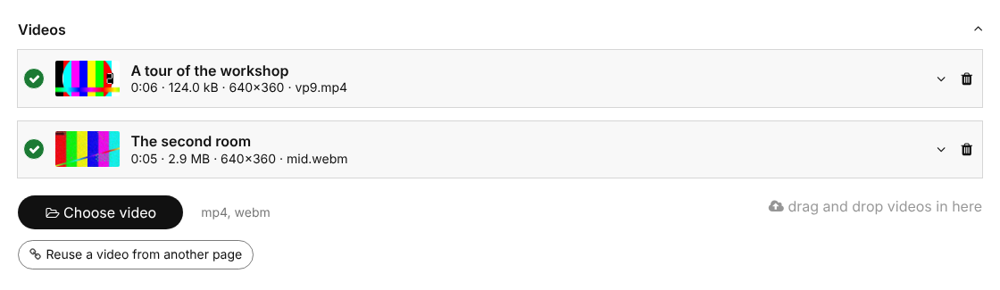
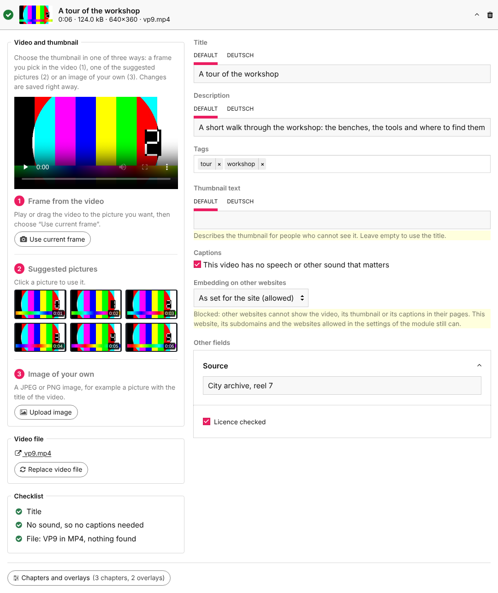
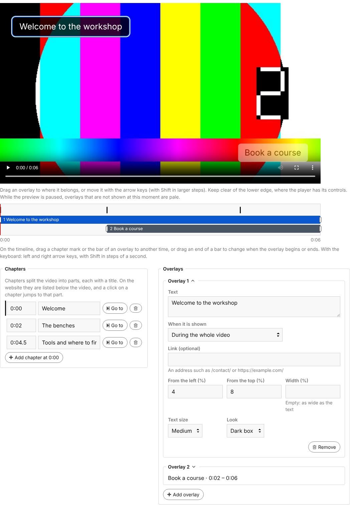
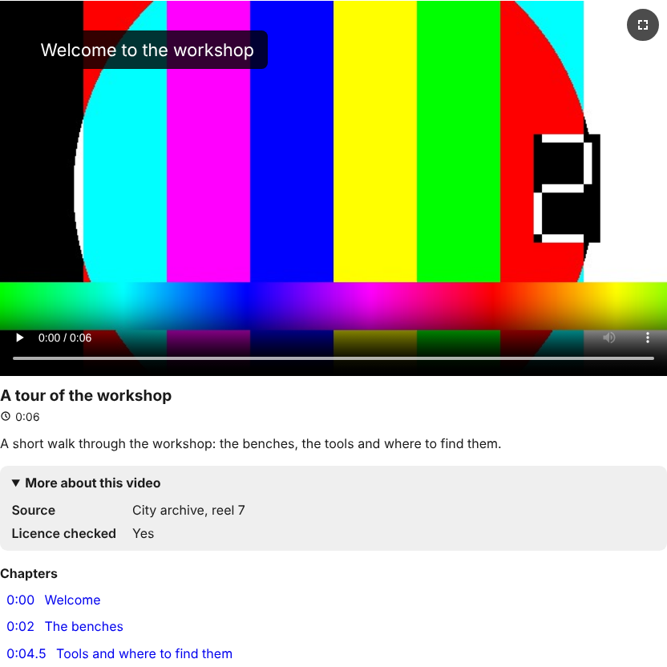
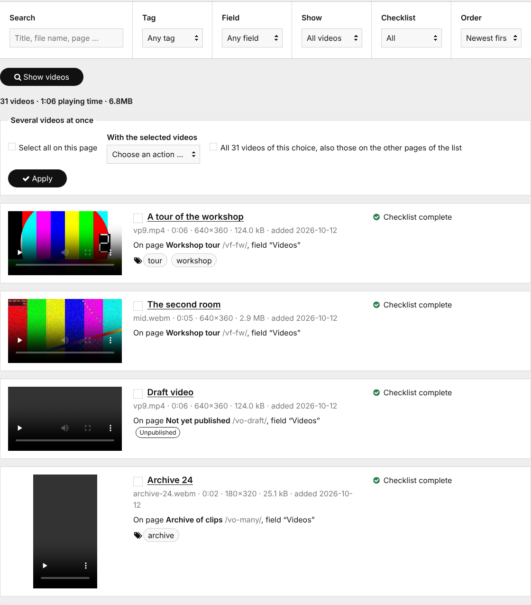

# FieldtypeSelfHostedVideo
[](https://opensource.org/licenses/MIT)
[](https://github.com/processwire/processwire)

A field for self-hosted video files for the ProcessWire CMS, shown in the module list as **Video Files**.
It builds on the core file field, so uploading, descriptions, tags, sorting and multi-language support work the way
editors know them. The videos stay on your own server: no external video platform, no cookies, nothing sent to others.

The documentation of every detail is in [docs/DOCUMENTATION.md](docs/DOCUMENTATION.md).

## Requirements
* ProcessWire>=3.0.227
* PHP>=8.1
* No ffmpeg and no PHP extensions beyond what ProcessWire needs

## Purpose of this module

Editors upload a video to a page like any other file, add a title, a description, captions and chapters, and the
website shows it in an accessible player. Large files, slow connections and search engines are looked after by the module.

## Benefits
* Upload of large files in parts, which goes on after an interrupted connection; a video can be replaced and keeps all
  its details
* A checklist per video (title, captions, format, size, picture, search engines) tells the editor what is still to do
* Thumbnail made in the browser, duration and dimensions read from the file
* MP4 files are prepared for streaming, so that a video starts before it is fully loaded
* Captions (WebVTT and SubRip) in several languages, with a transcript below the video
* Chapters and overlays (text and links at a moment of the video) with an editor and a preview
* Output with one line of code: lazy loading, a stable size while the page loads, one video plays at a time
* Structured data (`VideoObject`), Open Graph tags and an optional video sitemap for search engines
* Videos in a text with a tag and a button in TinyMCE and CKEditor
* Protected videos for pages that only some visitors may see, and a setting against embedding on other websites
* Anonymous play statistics per video, without cookies
* Reuse of a video on other pages without a second copy of the file
* An overview of all videos of the site in the admin (Setup > Video Manager)
* Class names for UIkit 3, Bootstrap 5 and Bulma; more frameworks as one file each
* German translation included

## Screenshots

### In the page editor




### Chapters and overlays


### On the website


### The overview of all videos


## How to install

1. Download the module and place the folder named "FieldtypeSelfHostedVideo" in /site/modules/.
2. In the admin control panel, go to Modules and click "Refresh". Find **Video Files** and click "Install". The video
   input, the Video Manager (Setup > Video Manager) and the text formatter "Videos in text" are installed along with it.
3. Create a new field under Setup > Fields with the type **Single video** or **Multiple videos**.
4. Add the field to a template.

New fields accept `mp4`, `webm` and `mov` files. The Video Manager is open to superusers; for other users give a role the
permission `video-overview`.

## Output on the website

```php
echo $page->videos->render();                      // all videos of a field
echo $page->video->render();                       // a single video field
echo $video->render([ 'description' => false ]);   // with options
```

`render()` returns a native `<video>` element with the browser's own controls and, below it, title, duration,
description, transcript and chapters. Each part can be switched off with an option, for example:

```php
echo $video->render([
    'autoplay'   => false,
    'loop'       => false,
    'lazy'       => true,       // false for a video at the top of a page
    'caption'    => true,       // title, duration and description below the video
    'transcript' => true,       // the text of the captions, in a box that opens
    'chapters'   => true,
    'overlays'   => true,
    'start'      => '1:23',     // moment to start at
    'framework'  => 'uikit3',   // class names of a CSS framework
]);
```

A video as a background of a section:

```php
<section class="hero shv-video-host">
    <?= $page->hero_video->render([ 'background' => true, 'shade' => 0.4 ]) ?>
</section>
```

A visitor who comes back goes on where they stopped, and a link such as `/page/?t=83` starts a video at a moment.

## What each video knows

```php
foreach($page->videos as $video) {
    echo $video->url;          // /site/assets/files/1234/intro.mp4
    echo $video->title;        // title in the current language
    echo $video->description;  // description in the current language
    echo $video->durationStr;  // 1:33
    echo $video->width;        // 1920
    echo $video->height;       // 1080
    echo $video->thumb->url;   // the thumbnail, a regular image
}
```

The video properties are searchable:

```php
$pages->find('videos.duration>60');
$pages->find('videos.tags=tutorial');
$pages->find('videos.ratio<1');         // portrait videos
```

Captions, chapters and overlays are available as `$video->captions()`, `$video->chapters()` and `$video->overlays()`.

## Videos in a text

Add the text formatter **Videos in text** to a text field (Setup > Fields > the field > Details). The text then shows a
video wherever it has a tag such as `[[video intro.mp4]]`, and the rich text editor of the field gets a button
"Insert video" that lists the videos of the page and writes the tag.

## Module configuration

Under Modules > Video Files:

* Embedding on other websites: allowed or blocked (each video can differ)
* Preparing videos for streaming: on by default
* The CSS framework of the website
* Where the stylesheet and script are added
* Statistics, Open Graph tags, video sitemap and the Video Manager under Setup

Per field you set the allowed file extensions, the data rate and file size from which a video gets a warning, tags and
the custom fields of a video.

## Protected videos and embedding

Videos on pages that only some visitors may view are given only to those who may see them, if the files of such pages are
protected in ProcessWire (`$config->pagefileSecure = true;` or per template). Whether other websites may show your videos
with the address of the file is a setting of the module. Details and the rules for Apache and nginx are in the
[documentation](docs/DOCUMENTATION.md).

## Multi-language

The module supports multiple languages: titles, descriptions and captions can differ per language. A German translation
comes with the module in `languages/de.csv`; install it in Modules > Site > Video Files. With the module RockLanguage it is
installed with the other translations.

## Documentation

* [Full documentation](docs/DOCUMENTATION.md): the page editor, all options of `render()`, text tags, protected videos,
  embedding, captions, chapters, search engines, CSS frameworks, the Video Manager, translating the module and upgrading
* [CHANGELOG.md](CHANGELOG.md)

## How to uninstall

ProcessWire allows to uninstall a fieldtype only when no field uses it. Delete the video fields under Setup > Fields first
(this deletes their videos), then uninstall **Video Files**. The module then removes the video sitemap file it made, its
table of the places of the videos and its statistics; the video input, the Video Manager and the text formatter are
separate modules, which you uninstall in the same way if ProcessWire does not do it for you.

## License

MIT, see [LICENSE](LICENSE).
