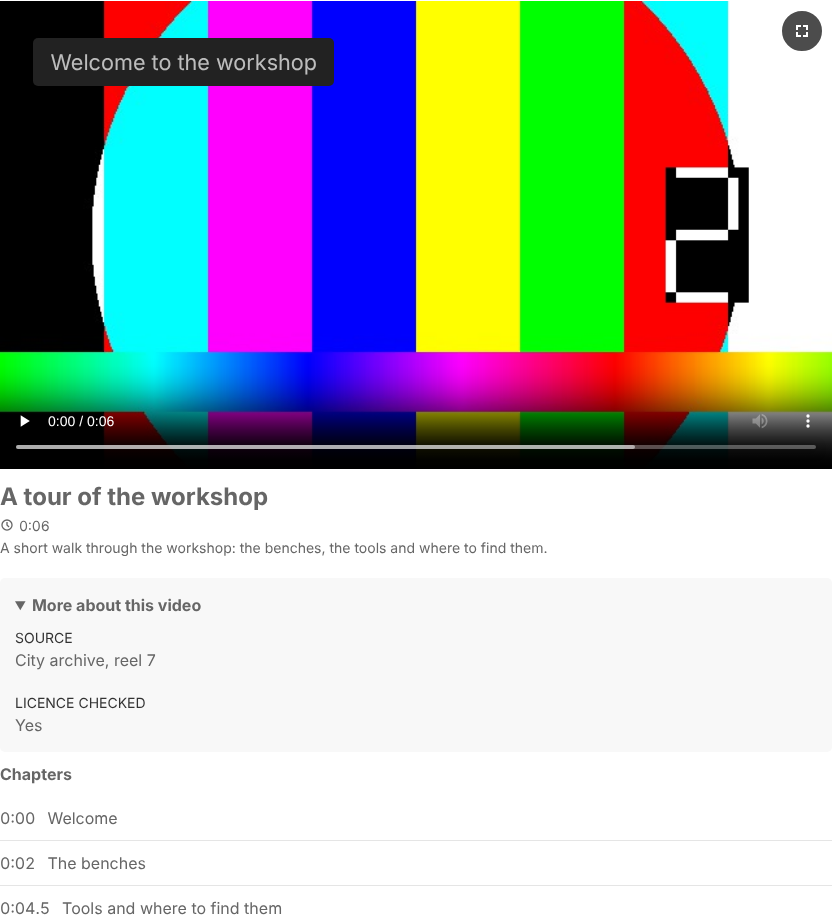

# Video Files for ProcessWire: documentation

The complete documentation. The short overview is in the [README](../README.md).

A field for self-hosted video files. It builds on the core file field, so uploading,
descriptions, tags, sorting and multi-language support work the way editors know them.

## Requirements

- ProcessWire 3.0.227 or newer (tested on 3.0.227 and 3.0.259)
- PHP 8.1 or newer
- No ffmpeg and no PHP extensions beyond what ProcessWire needs

## Installation

1. Copy the `FieldtypeSelfHostedVideo` folder to `/site/modules/`.
2. In the admin go to Modules > Refresh, then install **Video Files**. The video input,
   the overview of all videos (Setup > Video Manager) and the text formatter "Videos in text"
   are installed along with it.
3. Add a field under Setup > Fields and choose **Single video** or **Multiple videos**.
4. Add the field to a template.

New fields accept `mp4`, `webm` and `mov` files and have tags switched on.

The overview is open to superusers. For other users, give one of their roles the
permission `video-overview` (Access > Roles). It is optional: see "The overview of all videos".

### Coming from FieldtypeVideoFile (0.39.0 and earlier)

Up to version 0.39.0 the module was called **FieldtypeVideoFile**. Since 0.40.0 it is
**FieldtypeSelfHostedVideo**. The videos, the fields and the settings are taken over;
nothing has to be entered again.

1. Do **not** uninstall the old module. That would only be possible after deleting the video
   fields, and with them the videos.
2. Delete the folder `/site/modules/FieldtypeVideoFile/`.
3. Copy the folder `FieldtypeSelfHostedVideo` to `/site/modules/`.
4. Go to Modules > Refresh and install **Video Files** (FieldtypeSelfHostedVideo). Messages
   about the missing FieldtypeVideoFile between steps 2 and 4 are expected.

The installation finds what the old module left and moves it to the new names, in one go:

- the type of the video fields, their input, and the text formatter "Videos in text" in text fields;
- the button of TinyMCE and CKEditor, also where a template overrides the settings of a field;
- the settings of the module and its parts; the Video Manager is under Setup again if it was
  there before, and left out if it was switched off (its permission and roles stay as they are);
- the rules for embedding in the `.htaccess` files of pages;
- the German translation (or any other), with no new import;
- your own framework profiles: `/site/templates/videofile/` becomes `/site/templates/selfhostedvideo/`;
- the log `videofile` becomes `selfhostedvideo`.
- video fields that still allow only the old default `mp4 webm` also allow `mov`, as
  Modules > Refresh does since 0.34.0.

As long as the old folder is still there, the new module refuses to install and says so.

What you change yourself, in your own templates, stylesheets and scripts:

| Before | Now |
|---|---|
| `$modules->get('FieldtypeVideoFile')` | `$modules->get('FieldtypeSelfHostedVideo')` |
| `$modules->get('TextformatterVideoFile')` | `$modules->get('TextformatterSelfHostedVideo')` |
| class names `fvf-video…` | `shv-video…` |
| attributes `data-videofile-…` | `data-shv-…` |
| events `videofile:play` and the others | `shv:play` … |
| custom properties `--videofile-max-height` and the others | `--shv-max-height` … |
| the script's name `window.FieldtypeVideoFile` | `window.FieldtypeSelfHostedVideo` |
| `VideoFile.css`, `VideoFile.js` included by hand | `assets/SelfHostedVideo.css`, `assets/SelfHostedVideo.js` |
| nginx variables `$videofile_refuse`, `$videofile_check` | `$shv_refuse`, `$shv_check` (only names; see "Embedding on other websites") |

Unchanged: the tags in texts (`[[video intro.mp4]]`), the API of a video (`$page->videos`,
`render()`, `Pagevideo`), the permission `video-overview`, the title "Video Files".

### Upgrading

Replace the folder and go to Modules > Refresh. If you use the German translation,
install it again afterwards (see "Translating the module"). Parts that are new since your version
(the video input in 0.2.0, the overview of all videos in 0.9.0, the text formatter
"Videos in text" in 0.10.0) are installed on the next page load.

The notes below for older versions use the names of the time (`FieldtypeVideoFile`, `fvf-video` …).

Changed in 0.16.0, so that nothing of the module can meet a name of another module or of
your theme:

- Every class name of a video on the website now begins with `fvf-video`: what was
  `videofile` is `fvf-video`, `videofile__overlay` is `fvf-video__overlay`,
  `videofile--portrait` is `fvf-video--portrait`, `videofile-text` is `fvf-video-text`,
  `videofile-plain` is `fvf-video-plain`, `videofile-host` is `fvf-video-host`. Rules of
  your own stylesheet and scripts that use the old names need the new ones.
- The scripts add one name to a page, `FieldtypeVideoFile`. `VideoFile.init(element)` is
  now `FieldtypeVideoFile.player.init(element)`.
- Unchanged: the attributes (`data-videofile-…`), the events (`videofile:play` …), the
  custom properties (`--videofile-max-height` …) and the tags in texts.

New in 0.15.0: a module setting that shows video fields in tabs of their own in the page
editor. Four new texts: install the German translation again.

New in 0.14.1: in the editor for chapters and overlays a short note below the heading
"Chapters" says what chapters are for. One new text: install the German translation again.

New in 0.14.0: a profile for Bulma. Also fixed, with or without a profile: in a text area
whose stylesheet numbers and indents every list (Bulma's `content`, and the like in many
themes) the chapters of a video were numbered and indented too; and on websites with Bulma
the title below a video was not bold.

Fixed in 0.13.3: on websites with Pico CSS 2 the overlays lost their rounded corners, and,
where Pico's stylesheet was loaded after the module's, their places on the picture; the
buttons on the picture then looked like Pico's buttons.

Fixed in 0.13.2: on websites whose stylesheet marks all links with a border (the "Default"
site profile again), every chapter had a line below it, which made a double line between
chapters with the UIkit 3 profile, and overlays that are links had a line at their lower edge.

Fixed in 0.13.1: a video with a caption (`'caption' => true`) could not be seen on websites
whose stylesheet gives all figures a width, as the "Default" site profile of ProcessWire does.

New in 0.56.0: the stylesheets and scripts of the module are in a folder of their own, `assets/`
(`assets/SelfHostedVideo.css`, `assets/SelfHostedVideo.js` and the files of the page editor, the Video Manager
and the rich text editors). The module loads them from there by itself. **If your templates include
`SelfHostedVideo.css` or `SelfHostedVideo.js` by hand** ("I add them to my templates myself"), change the address to
`/site/modules/FieldtypeSelfHostedVideo/assets/…`. The profiles for CSS frameworks stay in `frameworks/`.

New in 0.55.2: unit tests for the module (folder `tests/`, see `tests/README.md`).
Nothing changes for visitors or editors.

New in 0.55.1: the button with a link at the end of a video opens a page of this website in
the same window, a page of another website in a new one (with a sign for it, and the words
"opens in a new window" for screen readers). Two new texts: install the German translation again.

New in 0.55.0, in the Video Manager: **videos uploaded more than once** are found (the same
file on several pages) and can be merged into one that the others reuse, which frees their
space ("Videos uploaded more than once"); **Replace video file** at each video, which leads
to that button in the page editor; and **Plays in detail**, a page with the plays per day or
week, how far viewers watch, and the numbers as a table ("Plays in detail"). A video that gets
another file name (replaced by another format, or renamed) keeps its plays, and tags in texts
that place it follow the new name. 68 new texts: install the German translation again.

New in 0.54.1: in the upload area of the field, “drag and drop videos in here” is on the same line as the allowed file extensions.

New in 0.54.0, in the Video Manager: sorted by plays (most or least watched in the last 30
days), the choices "Placed in a text", "Not watched in the last 30 days" and "Viewers stop
early", and a list of the video tags in texts that show nothing. New texts: install the
German translation again.

New in 0.53.0: `render()` leaves out videos that a text of the same page shows with a tag,
so that they are not on the page twice; `'includeall' => true` renders them all the same.
Templates that relied on `render()` showing every video, also those of a text, need
`includeall`.

New in 0.52.0: a long video goes on where the visitor stopped (kept in their browser only),
an end action per video (watch again, the next video, a link button), and anonymous counts of
plays in the page editor and the Video Manager ("Last 30 days: 142 plays · 61% watched to the
half · 38% to the end"). New texts: install the German translation again.

New in 0.51.0: deleting a video that a text of its page places with a tag warns: in the page
editor as soon as the video is marked for deletion, in the Video Manager when it asks before
deleting, and after saving, naming the texts that show nothing now. New texts: install the
German translation again.

New in 0.50.0: the module keeps a list of where each video is placed (its own page, the pages
that reuse it, texts with its tag) and shows it for each video in the page editor and in the
Video Manager ("Placed on 2 pages: …"); `$video->usage()`, `$video->usedOnPages()`. The list is
made for all pages after the upgrade. A notice in the admin says when the video sitemap was
written again. New texts: install the German translation again.

New in 0.49.0: the Open Graph tags of the first video are added to the `<head>` of the page by
`render()` (option `'opengraph' => false` to leave them out), and the video sitemap is the file
`sitemap-videos.xml` in the root folder of the website, made by default (module setting "Do not
create a video sitemap"). New texts: install the German translation again.

New in 0.48.0, for search engines: the structured data names the same thumbnail as the player
(before, it named the image at its stored size, which search engines take for another one), and
the language of the page (`inLanguage`). Three new points on the checklist (thumbnail missing or
too small, no description, the same title as another video), a video sitemap at
`/sitemap-videos.xml` (module setting "Video sitemap", off by default) and Open Graph tags for
sharing (`$page->videos->metaTags()`). See "Search engines". New texts: install the German
translation again.

New in 0.47.0: a handle to move each video in the page editor, by dragging, with the arrow
keys or with a menu (to a position, also on another page of the list). Twelve new texts:
install the German translation again.

New in 0.46.0: **Per page** below a list of videos in the page editor (Show all, 5, 10, 15, 20,
30, 50), kept in the browser. Two new texts: install the German translation again.

New in 0.45.0: pages also for video fields in the page editor, 10 videos per page by default
(module setting "Videos per page in the page editor"). Two new texts: install the German
translation again.

New in 0.44.0: numbered pages in the Video Manager, 10 videos per page by default (module
setting "Videos per page in the Video Manager"; before, the list had 24 per page). Six new
texts: install the German translation again.

New in 0.43.0: a new design of the actions on several videos in the Video Manager: one bar
above the list, with the actions once videos are selected (see "Several videos at once").
Three new texts: install the German translation again.

Changed in 0.42.1: the bar with **Save** at the bottom of the screen is gone; **Back to top**
at the foot of each video leads to the save button of the page editor.

New in 0.42.0: **Back to top** at the foot of each video instead of in the bar at the bottom of
the screen, which keeps **Save**. One new text: install the German translation again.

Fixed in 0.41.1: the move from FieldtypeVideoFile left video fields with the old default
`mp4 webm` without `mov`. The move now adds it, and on sites already moved with 0.40.0 or
0.41.0, Modules > Refresh adds it once (the admin names each field it changed).

New in 0.41.0: a video that is too large gets free tools for making it smaller in its checklist, and the button **Replace video file** right there (see "Too large: tools for making a video smaller"). Twelve new texts: install the German translation again.

New in 0.40.0: the new name FieldtypeSelfHostedVideo (see "Coming from FieldtypeVideoFile").

New in 0.39.0: the Video Manager under Setup is optional (module settings).

New in 0.38.0: texts entered for a video are limited in length and cleaned of control
characters; a number that cannot be stored no longer loses the data of a video; bulk
actions respect edit rights set for a field.

New in 0.37.0: the question before leaving the page covers every step of an upload, also a
file that is being checked, waits for its turn or for a decision, and the last step.

New in 0.36.0: a bar with **Save** and **Back to top** at the bottom of the screen while a
long list of videos is edited.

New in 0.35.0: embedding on other websites can be blocked, for the whole site and for each
video (see "Embedding on other websites").

New in 0.34.0: MOV files are allowed by default (video fields that still allowed only the
old default "mp4 webm" get MOV at Modules > Refresh), and the button that chooses files
opens the videos and the video camera on phones.

New in 0.33.0: **Pause** and **Continue** for an upload, and a line for all files when
several are uploaded at once.

New in 0.32.0: an upload interrupted by a reload, a crash or a closed browser goes on
where it stopped when the same file is chosen again (see "Continue after a reload or crash").

New in 0.31.0: uploads show the speed and the time left, wait for the connection when the
computer is offline, and files are checked before they are sent (see "Upload" and "Check
before uploading").

New in 0.30.0 (layout in 0.30.1): three numbered ways to the thumbnail: a frame from the video, six
suggested pictures, an image of your own.

New in 0.29.0: captions can be edited in the page editor ("Edit" next to each language).

New in 0.28.0: actions on several videos at once in the Video Manager (prepare for
streaming, add or remove a tag, delete), and the choices "Not prepared for streaming" and
"Not on a published page" (see "Several videos at once").

New in 0.27.0: MP4 and MOV files are prepared for streaming (their index moved to the
front of the file, nothing converted), by itself on upload and with a button in the checklist
of videos that are already there (see "Prepared for streaming").

New in 0.26.0: a transcript of the captions below a video, shown by default in a box that
opens; the time of each paragraph plays the video from there (see "Transcript").

New in 0.25.1: the German translation also comes in `RockLanguage/DE/`, for sites that
use the module RockLanguage (see "Translating the module").

New in 0.25.0: a video field can be kept out of the tabs of the module (Setup > Fields >
the field > Input > "Never in a tab").

New in 0.24.0: video fields can also be shown together in one tab "Videos" of the page
editor (Modules > Video Files > "Video fields in the page editor").

New in 0.23.0, and a change to what `render()` shows by default: below a video come its
title, its duration, its description, the box with what its custom fields say, and its
chapters, in this order. Before, title and description (`caption`) and the box (`info`)
were only shown when asked for. To keep the old output, leave them out:
`render([ 'caption' => false, 'info' => false ])`. The same goes for videos in texts
(`[[video intro.mp4 nocaption noinfo]]`). Without a CSS framework the title is larger,
the duration is a smaller line with a clock, and the box is a light panel. With a
framework profile the parts get its class names as before; the line with the duration
is the new part `meta`, and the box is a panel of the framework (UIkit tile, Bootstrap
card, Bulma box).

New in 0.13.0: a profile for Bootstrap 5.

New in 0.12.0: videos on the website can get the class names of a CSS framework (see
"CSS frameworks"). Nothing changes until you choose one in the module settings. An
overlay that is a link now keeps the text colour of its box while the pointer is on it,
also where the website gives links another colour there.

Coming from a version before 0.7.0:

- The `<video>` element is no longer a direct child of the `fvf-video` element. It now
  sits in `fvf-video__screen` > `fvf-video__frame`, where the overlays lie on it. Rules of
  your own such as `.fvf-video > video` need the new path; `.fvf-video__video` works as before.
- Each video is rendered with an `id` (`video-intro-mp4`).
- Chapters and overlays that were entered before now show up on the website. Use the
  `overlays` and `chapters` options where you do not want them.
- Thumbnails keep their file names until they are replaced; from then on see "Thumbnail".

## In the page editor


- **One item per video:** in a field for several videos each video is a closed item.
  Its header shows the thumbnail, the title (the file name while there is none), the
  duration with size, dimensions and file name, and a sign: a tick when the checklist
  has no open points, an exclamation mark when it has. A click on the header, or Enter
  or Space, opens the video to work on it, and closes it again. Several videos can be
  open at once. A video that was just uploaded arrives open, and videos that are open
  when the page is saved are open afterwards. Videos are sorted by dragging them at
  their headers. A field for one video shows that video open, without a header to click.
- **An opened video** has two columns. On the left are its areas, each a group with a
  line around it and its name: **Video and thumbnail** (the preview, with the buttons
  that choose its thumbnail), **Video file** (the name of the file as a link, and
  "Replace video file"), **To place in a text** (the tag and what it is for, where a
  text field of the page understands it) and **Checklist**. On the right are its
  inputs: title, description, tags, thumbnail text, captions and custom fields. The
  editor for chapters and overlays uses the same groups: one for the chapters, one
  for the overlays, and one for each overlay inside it. An overlay is closed until its
  name is clicked, and says in a line what it shows and when; a new one arrives open.
- **File types:** a new video field allows MP4, WebM and MOV (what iPhones record); the
  list is the field's setting "Valid file extensions". The button that chooses files asks
  for videos: on a phone it opens the videos of the gallery and the camera in video mode,
  on a computer the file dialog shows videos. iPhones record in HEVC (H.265) unless set to
  "Most Compatible" (Settings > Camera > Formats); the checklist names HEVC and how to
  export the video as H.264, which every browser plays.
- **Upload:** videos are sent to the server in parts, so their size does not depend on
  the upload limits of the server. A bar shows the progress, with the speed and the time
  left ("42% · 120 MB of 290 MB · 3.2 MB/s · about 2 min left"). An upload can be
  cancelled, continues by itself after a short loss of connection, and after a longer one
  with **Try again**, from where it stopped. When the computer is offline, the upload says
  so and goes on by itself once the connection is back. **Pause** stops sending right away
  and becomes **Continue**; what has arrived stays on the server. Several files are sent one
  after the other; while two or more are on their way, a line above the button that chooses
  files tells how far they are together ("Video 2 of 4 · 38% of 1.2 GB in total · about
  5 min left").
- **Continue after a reload or crash:** what has arrived of an upload stays on the server
  for a day after its last part, and the editor's browser remembers the upload. When the
  page is opened again, the field says which upload was interrupted and how far it got,
  with **Choose file again** and **Discard**. Choosing the same file (also the usual way, or
  by dropping it) goes on where it stopped. Before it does, the server compares the start
  of the file and the 64 kB before that point with what it has; a different file starts over.
- **Leaving the page:** while a video is on its way (being checked, waiting for its turn or
  for a decision, being sent, paused, waiting for the connection, or being added to the page
  at the end), the browser asks before the page is closed, reloaded or left, and the page
  editor asks before it is saved. Once all videos have arrived, nothing is asked.
- **Check before uploading:** the editor's browser looks at each file before it is sent.
  The duration and size of the picture are shown while it uploads. A file the browser
  cannot play (a codec such as HEVC, or a damaged file) is not sent right away: the editor
  is told why and chooses **Upload anyway** or **Do not upload**, while the other files go on.
- **Preview:** each video can be played in the editor. Its duration, file size and
  dimensions are shown in its header.
- **Long lists:** a field with more than 10 videos shows them in pages (module setting
  **Videos per page in the page editor**, 1 to 100, for all video fields, in a tab or not).
  Below the list: "Videos 11–20 of 24", the page numbers, **Previous** and **Next**, and
  **Per page** (Show all, 5, 10, 15, 20, 30, 50), which each editor can change; the choice is
  kept in the browser and holds for all video fields until it is changed again. Saving
  keeps the page; a new video, a link to one video (from the Video Manager) and an input
  that needs attention show their page. Each video ends with **Back to top**, which leads
  to the top of the page, where it is saved.
- **Order:** each video has a handle (six dots) at the start of its header. Drag it to move
  the video; while it is dragged all videos are closed and a dashed slot shows where it will
  land. With the keyboard, the arrow keys on the handle move the video one place (Home and End
  to the start and the end). A click on the handle opens a menu: up one place, down one place,
  to the start, to the end, to a position (also across the pages of a long list). After
  saving, the website shows the videos in the new order (`$page->videos` and `render()`).
- **Title, description, thumbnail text:** one input per language. Tags as set up for the field.
  What is entered is kept as one line of text without control characters, a title and a
  thumbnail text up to 255 characters, a description up to 5000 (with line breaks where the
  field shows it in several rows). Markup stays as typed; it is text, which the output
  escapes, unless text formatters of the field say otherwise (by default the field encodes
  entities).
- **Thumbnail:** created in the editor's browser right after upload, two seconds into
  the video (the position is a field setting on the Input tab). Videos that have no
  thumbnail yet get one when their page is opened in the editor. To choose another one,
  the area **Video and thumbnail** explains in a sentence the three ways, then shows them as
  numbered parts, each with its title and separated by a line:
  1. **Frame from the video:** play or drag the video to the picture you want and choose
     **Use current frame**.
  2. **Suggested pictures:** six pictures spread evenly over the whole video; a click uses
     one (the one in use is marked). They are made in the editor's browser once the video
     comes into view, and nothing is stored until one is chosen.
  3. **Image of your own:** **Upload image** (JPEG or PNG).

  Thumbnail changes are saved right away, not with the Save button.
- **Replace video file:** uploads a new file for a video and keeps its title,
  description, tags and thumbnail text. A thumbnail taken from the video is taken again
  from the new file, an uploaded image stays. Pages that reuse the video follow, also
  when the new file has another format; so do its plays and the tags in texts that place
  it (`[[video intro.mov]]` becomes `[[video intro.mp4]]`, options stay). This takes effect
  right away. In the Video Manager, **Replace video file** at each video leads here.
- **Captions:** choose a language and add a WebVTT (.vtt) or SubRip (.srt) file. SubRip
  files are converted. Captions are saved right away, can be tried in the preview player,
  and a file for a language that has captions takes their place. A video without speech
  can be marked as such with the checkbox right below the heading "Captions"; while it is
  checked, everything else about captions is hidden. **Edit** next to a language shows the text of its captions to
  correct a typo or a time right there; "Save captions" saves them at once (as a new file
  for that language, keeping its name and whether it is captions or subtitles), and the
  preview player, the checklist and the transcript follow. Text that is no captions is
  refused, and stays in the editor to be fixed. Escape or "Cancel" closes the editor;
  with changes it asks first.
- **Custom fields:** ProcessWire's custom fields for files work for videos as well.
  Create a template named `field-` plus the name of the video field (`field-videos`
  for a field `videos`) and add the fields you need: a source, a licence, credits.
  Each video shows them below its captions under the heading "Other fields" (only where
  there are some), they are saved with the page, and in a
  template file they are read like any other property: `$video->source`. A rich text
  field among them gets its editor when the video is opened. Where the video field
  is only shown (locked, or no right to edit it), they are written as text. On the
  website a video can show them in a box that opens: see "More about a video: its
  custom fields".
- **Checklist:** each video shows what is missing for people who cannot see or hear it
  (title, captions) and what about the file will trouble visitors: a format not every
  browser plays, an MP4 that has to load completely before it starts, a data rate too
  high for phones. The header of the video says how many points are open: as a label
  in a field for one video, as the text of the sign in a field for several. Nothing is
  blocked: these are hints.
- **Chapters and overlays:** a button below each video opens an editor with a large
  preview, a timeline and two lists.
  - A *chapter* is a titled moment: move the preview to where it begins and choose
    "Add chapter". Times can also be typed (`1:23`).
  - An *overlay* is a short text on the picture that can also be a link. Drag it to
    where it belongs, or move it with the arrow keys or by entering its position.
    "When it is shown", right below its text, decides between the whole video, a part
    of it (from one time to another, typed or taken from the preview with "Now"), and
    the end of the video. Two looks (dark or light box) and three text sizes.
  - On the *timeline*, times can be changed by dragging: a chapter mark to where the
    chapter begins, the bar of an overlay to another time (it keeps its length), and
    either end of a bar to where the overlay begins or ends. Pulling in an end of a
    bar that spans the whole video turns the overlay into one for a part of it. The
    preview follows, so you see the picture of that moment, and a note shows the time.
    Times snap to tenths of a second. With the keyboard: the left and right arrow
    keys move what has the focus by a tenth of a second, with Shift by a second; on
    an end of a bar, Home, End, Page Up and Page Down work too. A click without
    dragging still jumps to the chapter or opens the overlay.
  - Texts and links are entered per language, with buttons to switch. Position, look
    and times are the same in every language.
  - While the preview plays it shows what visitors will see. Paused, all overlays can
    be reached, and those not shown at that moment are pale.
  - Chapters and overlays are saved with the page, unlike thumbnails and captions.
- **Reuse a video from another page:** the button below the upload opens a search
  across the videos of all pages you may view: by title, description, file name, page
  or tag. "Use this video" shows the video in this field without a second copy of its
  file, and saves that right away. In a field for one video it takes the place of the
  video that is there. The button is there only while there is a video to reuse: one of
  another page you may view, or of another video field of this page, that the field
  does not show yet. A field can be limited to uploads in its settings ("Uploads only").
- **Reused videos** appear as a read-only card that names the page they come from.
  Removing one takes it off this page and leaves the original alone.
- **In a text:** where a text field of the page has the text formatter "Videos in text",
  each video shows the tag that places it in the text, and the rich text editor has a
  button for it. See "Videos in a text".
- **A video that other pages show** says so, with links to those pages, and has a lock
  in place of the delete checkbox: it can be deleted once it is removed there. The same
  goes for its page: the Delete tab names the videos and pages that stand in the way.
- In a single video field, uploading another video takes the place of the first. This is
  refused while other pages reuse that video.

Things to know:

- A thumbnail can only be taken from a video the editor's browser can play. If it cannot,
  the editor is told and can upload an image.
- If the web server does not answer range requests for video files, browsers cannot jump
  to a position in a video, and the thumbnail is the first picture of the video.
- An upload that is not finished cannot be continued after the page was closed or
  reloaded. What it left on the server (in `/site/assets/cache/FieldtypeSelfHostedVideo/`)
  is removed after a day.
- A size limit for videos can be set per field, on the Input tab ("Largest video file").
  Without it, only the free space on the server limits a video.
- The data rate above which the checklist points out a video (8 Mbit/s by default) and
  an optional file size are set on the Input tab as well.
- Whether a browser can play a file is known for the browser of the editor only. When it
  cannot, the checklist says so and names the browser.
- Where the page editor's background upload is not available (JavaScript switched off,
  or a browser from before 2021), videos are uploaded the way files are, within the
  server's limits.

### Tabs for video fields

By default a video field sits among the other fields of a page. Under Modules > Video Files,
"Video fields in the page editor" offers two other places:

- **Each video field in a tab of its own**, named after the field and placed right after
  "Content". With several video fields in a template (one for a single video, one for
  many), each gets its tab.
- **All video fields together in one tab "Videos"**, right after "Content", in the order
  of the template.

A video field that is hidden, that sits in a fieldset or in a tab, or that belongs to a
repeater item stays where it is. So does a field whose own setting **"Never in a tab"** is
checked (Setup > Fields > the field > Input, also per template): it always stays among
the other fields of the page, whatever the module setting says. A field edited on its own (as front-end editing does) is
shown without tabs. For a single field ProcessWire has the same built in: Setup > Fields >
(the field) > Input > Visibility > "Tab", which can also be set for one template only.

## Showing videos on the website


```php
echo $page->videos->render();              // all videos of a field
echo $page->video->render();               // a single video field (check that it has a video first)
echo $video->render([ 'description' => false ]); // without the description
```

`render()` returns a native `<video>` element with the browser's own controls. It

- takes the width it is given and keeps the video's proportions, so nothing jumps while
  the page loads. An upright video is never taller than the visible part of the page.
- loads nothing of the video file until the visitor plays it, and fetches the thumbnail
  only when the video comes near the visible part of the page.
- shows below the picture, in this order, the title, the duration, the description, a box
  with what the custom fields of the video say (see "More about a video"), the transcript
  of its captions (see "Transcript") and the chapters.
  Each of them can be left out with its option.
- uses the title as the video's name for screen readers.
- shows the overlays of the video on the picture, each at its time, and the chapters
  as a list of links (see "Chapters and overlays on the website").
- pauses the other videos of the page when one starts, and pauses a video that is
  scrolled out of view until it is back.
- adds structured data for search engines (see "Search engines").
- adds the stylesheet and script it needs along with the first video of a page.

### Options

```php
echo $video->render([
    'controls'    => true,    // show the player controls
    'autoplay'    => false,   // start by itself (the video is then muted, as browsers require)
    'muted'       => false,
    'loop'        => false,
    'playsinline' => true,    // play in place on phones instead of full screen
    'lazy'        => true,    // false for a video at the top of a page: thumbnail right away
    'preload'     => '',      // 'none', 'metadata' or 'auto' to decide yourself
    'poster'      => true,    // false for none, or an image or URL of your own
    'posterWidth' => 1280,    // the thumbnail is reduced to this width, 0 for its stored size
    'caption'     => true,    // title, duration, description below the video: false for none of them,
                              // 'title' or 'description' for one of them (with the duration), or a text of your own
    'title'       => true,    // the title below the video
    'duration'    => true,    // the duration below the title
    'description' => true,    // the description below the video
    'info'        => true,    // what the custom fields of the video say, in a box that opens: true, or the names of the fields
    'infoOpen'    => false,   // is that box open from the start?
    'infoLabel'   => '',      // the text of the line that opens it (default: "More about this video")
    'transcript'  => true,    // the text of the captions, in a box that opens: true, false, or 'open'
    'transcriptLang'  => '',  // language code of the captions to use (default: see "Transcript")
    'transcriptLabel' => '',  // the text of the line that opens it (default: "Transcript")
    'captions'    => true,    // caption tracks. 'de' also switches the German captions on from the start
    'overlays'    => true,    // show the overlays of the video on the picture
    'chapters'    => true,    // show the list of chapters below the video
    'fullscreen'  => null,    // the module's full screen button: by default for videos with overlays
    'start'       => null,    // moment to start at: seconds or '1:23'. By default what ?t= in the address asks for
    'single'      => true,    // pause other videos of the page when this one starts
    'pauseOutOfView' => true, // pause when scrolled out of view, go on when back
    'schema'      => true,    // structured data
    'opengraph'   => true,    // Open Graph tags of the first video in the <head> of the page
    'resume'      => true,    // go on where the visitor stopped (true: videos of a minute or longer; or seconds)
    'end'         => true,    // what is set for the end of the video: watch again, next video, link
    'includeall'  => false,   // also videos that a text of the page shows with a tag (see "Videos in a text")
    'class'       => '',      // class name(s) for the wrapping element
    'id'          => '',      // id of the wrapping element, by default "video-" and the file name: video-intro-mp4
    'attrs'       => [],      // more attributes for the video element, i.e. [ 'controlslist' => 'nodownload' ]
    'framework'   => null,    // class names of a CSS framework: 'uikit3', false for none. By default the module setting
]);
```

To change a default for the whole site, add a hook to `/site/ready.php`:

```php
$wire->addHookBefore('Pagevideo::render', function(HookEvent $event) {
    $options = (array) $event->arguments(0);
    $event->arguments(0, array_merge([ 'description' => false, 'info' => false ], $options));
});
```

### More about a video: its custom fields

Where the videos of a field have custom fields (see "In the page editor"), a video
shows what they say, a source or credits for example:

```php
echo $page->videos->render();                                        // all fields with a value
echo $video->render([ 'info' => [ 'source', 'credits' ] ]);          // only these fields, in this order
echo $video->render([ 'infoOpen' => true ]);                         // open from the start
echo $video->render([ 'infoLabel' => 'Sources' ]);                   // another text for the line that opens it
echo $video->render([ 'info' => false ]);                            // without the box
```

The fields appear in a box below the description that visitors open with a click: the
line "More about this video", and below it the fields as names and values. The chapters
follow it. Fields without a value are left
out, and so is a checkbox that is not checked; a video with nothing to say gets no box.
A reused video shows what its original says.

- **How it is built:** the box is a `<details>` element with its `<summary>`, the fields
  are a description list (`<dl>` with `<dt>` and `<dd>`). This is what the browser brings
  for a part that opens and closes: it works with the keyboard and without a script, and
  screen readers know it (they name it in different ways: a button, a disclosure
  triangle, a summary). In Chrome and Edge the search of the browser finds text inside a
  closed box and opens it. The marker in front of the line is the browser's own and is
  left in place, because it is how the line says that it opens something. The accordions
  of UIkit and Bootstrap are not used: they need the script of their framework and a
  markup of their own; the profiles for these frameworks give the box and its list their
  class names instead. The box is then a panel of the framework: a grey tile in UIkit
  (`uk-tile-muted`), a card in Bootstrap (grey with `bg-body-tertiary` from 5.3 on, white
  before), a box in Bulma (white with a shadow).
- **How values are written:** text as text, with its line breaks. Rich text and text
  that goes through text formatters as the field hands it out. An address as a link. A
  date in the format of its field. A checkbox and a yes/no field as "Yes" or "No". Pages
  by their titles.
- **Styling:** `shv-video__info` (the box), `shv-video__info-summary` (its line),
  `shv-video__info-list`, `shv-video__info-term` and `shv-video__info-value`. Names and
  values also carry `data-shv-info` with the name of their field, so that a rule
  can address one field: `[data-shv-info="source"]`. On screens narrower than 30em
  each value is below its name.
- **In a text:** `[[video intro.mp4 info=open]]` for the box open, `noinfo` without it.
- **In code:** `$video->info()` returns the same as an array, to write it your own way:

```php
foreach($video->info() as $item) {
    echo "<p><strong>$item[label]:</strong> $item[value]</p>";   // label is text, value is markup
}
$video->info([ 'source', 'credits' ]);   // only these, in this order
```

A hook after `Pagevideo::info` can add items of your own or change a value.

### Transcript

A video with captions shows their text as a transcript, in a second box that opens, below
the box with the custom fields and above the chapters. People who cannot hear the video, or
who would rather read, can read it there; search engines read it too.

```php
echo $video->render();                                   // with the transcript, closed
echo $video->render([ 'transcript' => 'open' ]);         // open from the start
echo $video->render([ 'transcript' => false ]);          // without it
echo $video->render([ 'transcriptLang' => 'de' ]);       // from the German captions
echo $video->render([ 'transcriptLabel' => 'Read along' ]);
```

- **Paragraphs:** the captions are joined into paragraphs. A new one begins where another
  voice speaks (`<v Anna>` in a WebVTT file), after a pause of two seconds or more, and at
  the end of a sentence once a paragraph has run for 20 seconds. A line the captions show
  twice in a row is written once. Styling of the captions (italic, colours) is left out.
- **Time and voice:** each paragraph begins with its time, a link that plays the video
  from there (screen readers hear "Play from 0:12"; without JavaScript it leads to that
  moment of the page, as chapter links do). Where the captions name who speaks, the name
  is in front each time another voice begins. While the video plays, the paragraph being
  spoken is marked (`data-shv-current`).
- **Which captions:** the language asked for with `transcriptLang`; otherwise those of the
  visitor's language (a ProcessWire language named like a language code, such as `de`);
  otherwise the first captions of the kind "captions" (as a rule the language spoken in the
  video, while "subtitles" are translations); otherwise the first. The text carries a
  `lang` attribute with the language of the captions.
- **Structured data:** the same text, the names in front, is the `transcript` of the
  VideoObject.
- **Styling:** `shv-video__transcript` (the box, a `<details>` like the box with the custom
  fields), `shv-video__transcript-summary`, `shv-video__transcript-body`,
  `shv-video__transcript-item` (a paragraph), `shv-video__transcript-time`,
  `shv-video__transcript-voice`. The profiles for CSS frameworks make the box the same
  panel as the box with the custom fields.
- **In a text:** `[[video intro.mp4 transcript=open]]`, or `notranscript`.
- **In code:** `$video->transcript()` returns the paragraphs (`time`, `timeStr`, `end`,
  `text`, `voice`, `lang`), `$video->transcriptText()` the plain text, and
  `$video->transcriptTrack()` the captions it is made from. `Pagevideo::transcript()` can
  be hooked.

### Going on where the visitor stopped

A visitor who stops watching a video of a minute or longer and comes back later goes on at
that place when they play it again; a note on the picture says so ("Continued at 3:12") and
offers "From the beginning". The place is kept in the visitor's browser only (`localStorage`,
for the last 50 videos and 60 days), with no cookie and nothing sent to the server. Near the
start or the end there is nothing to go on with, and a video played to its end is forgotten.

There is no going on where the address of the page asks for a moment (`?t=83`), where the
render() option `start` is given, for videos that loop or start by themselves, and where the
visitor moved in the video (a chapter link, say) before playing it. `'resume' => false` switches
it off for a video; `'resume' => 30` uses it for videos of 30 seconds or longer.

### At the end of a video

In the page editor, "At the end of the video" sets what the player offers on the picture when
the video has ended, always with a button to watch it again:

- **Nothing:** the last picture stays (the default).
- **Offer to watch it again.**
- **Offer the next video of this field:** "Next video: Title". A click brings it into view and
  plays it. Shown only where the page shows that video.
- **Show a button with a link:** an address of the site (`/contact/`), or one beginning with
  `https://`, `mailto:` or `tel:`, and a text per language (default "More"). A page of this
  website (an address such as `/contact/`, or one with a host name of `$config->httpHosts`,
  with or without "www.") opens in the same window; a page of another website opens in a new
  one, and the button shows a small sign for it (screen readers hear "opens in a new window").

The controls of the player stay usable below. Videos that loop have no end; `'end' => false`
leaves it out. Overlays shown "at the end" (see "Chapters and overlays") appear as well.

```php
$video->endAction('link');           // "", "replay", "next" or "link"
$video->endLink('/contact/');
$video->endText = 'Ask us';          // or $video->endText($language, 'Fragen Sie uns')
$page->save('videos');
```

### Statistics

The module counts how often each video is started on the website, and how many of those plays
reach a quarter, the half, three quarters and the end. The page editor and the Video Manager
show it for each video: "Last 30 days: 142 plays · 61% watched to the half · 38% to the end".

- The counts are anonymous: one row per video and day in the table `selfhostedvideo_stats`,
  without addresses, cookies or anything else about the visitor. The script reports to
  `/selfhostedvideo-stats` (with `navigator.sendBeacon`).
- Not counted: those who may edit the page, programs that say they are robots (or say nothing
  about themselves), videos the visitor may not view, and anything that is not one of the five
  events. A reused video counts for its original.
- Counts older than two years are removed; those of a deleted video or page go with it.
- The module setting "Statistics: Do not count plays" switches it off.
- A video that gets another file name keeps its counts; merged copies add theirs to the
  video that is kept (see "Videos uploaded more than once").

**Plays in detail.** In the Video Manager each video has the link **Plays in detail**, with a
small chart of its last 30 days. It leads to a page of its own (Setup > Video Manager >
plays) with the period (30 days, 90 days, 12 months, 2 years), three figures (plays, share
watched to the half and to the end), the plays per day as a chart (per week for the longer
periods; pointing at a column says its day and number), how far viewers watch (started, a
quarter, the half, three quarters, the end, each as a share of the plays) and the counts per
day as a table.

```php
$stats = $video->stats(30);   // the last 30 days, 0 for all
// plays, quarter, half, threeQuarters, end (percent of the plays), counts (the numbers)
$daily = $modules->get('FieldtypeSelfHostedVideo')->stats()->daily($video, 90);
// [ "2026-10-18" => [ plays, p25, p50, p75, p100 ], … ] for every day, oldest first
```

### Background videos

```php
<section class="hero shv-video-host">
    <?= $page->hero_video->render([ 'background' => true, 'shade' => 0.4 ]) ?>
    <h1><?= $page->title ?></h1>
</section>
```

A background video is muted, repeats, has no controls and fills the element it is placed
in, behind that element's content. Put it directly inside that element and give the
element the class `shv-video-host`. `shade` (0 to 1) darkens the video so that text on
it stays readable.

- It starts when it is visible and pauses when it is not.
- A round button in the lower corner lets visitors pause and play it. Moving content
  that cannot be paused is a barrier for many people, so leave the button in unless you
  provide one yourself (`'toggle' => false`).
- For visitors who asked their system for reduced motion or for data saving, it does not
  start. They see the thumbnail and can start the video with the button.
- It is hidden from screen readers and has no structured data, because it is decoration.

### Styling

Every class name of the module on the website begins with `shv-video` (`shv` for the name
of the module, FieldtypeSelfHostedVideo), so that none of them can meet a class name of your theme
or of another module. In the admin the class names begin with the names of the module's
classes (`InputfieldSelfHostedVideo…`, `ProcessSelfHostedVideos…`), as is usual for ProcessWire modules.

The markup uses these class names: `shv-video` (wrapper, also `shv-video--landscape`,
`shv-video--portrait`, `shv-video--square`, `shv-video--background`, and
`shv-video--playing` while the video plays), `shv-video__screen` and `shv-video__frame`
(the picture with its overlays), `shv-video__video`, `shv-video__overlays`,
`shv-video__overlay`, `shv-video__fullscreen`, `shv-video__chapters`,
`shv-video__chapters-label`, `shv-video__chapter-list`, `shv-video__chapter`,
`shv-video__chapter-time`, `shv-video__chapter-title`, `shv-video__caption`,
`shv-video__title`, `shv-video__meta` (the line with the duration), `shv-video__duration`,
`shv-video__description`, `shv-video__toggle`,
`shv-video__chapter-item`, and for the box with the custom fields `shv-video__info`,
`shv-video__info-summary`, `shv-video__info-list`, `shv-video__info-term` and
`shv-video__info-value`, and for the transcript `shv-video__transcript`,
`shv-video__transcript-summary`, `shv-video__transcript-body`, `shv-video__transcript-item`,
`shv-video__transcript-time` and `shv-video__transcript-voice`.
Margins and the look of caption and chapter list are set in a way that any rule of your
own stylesheet takes precedence.

A video with a title or description below it is a `<figure>` with a `<figcaption>`. A
caption has to be the last part of its figure, so the box with the custom fields and the
chapters are the end of the caption; the figure takes its name for screen readers from the
title alone (`aria-labelledby`), or from the description where there is no title. A video
without title and description is a `<div>` with the box and the chapters below the picture.
The duration is a `<time>` element with a clock in front and the word "Duration:" for
screen readers. Rules of your stylesheet for
all figures and captions (font size, colour, margins) apply to it, so that it looks like
the captioned images of your texts. Two things are kept from such rules, because a video
could not be seen with them: a `width` for all figures (the stylesheet of ProcessWire's
"Default" site profile makes figures one pixel wide tables) and a `display` for all
figcaptions. A rule with a class name, such as `.shv-video { width: 50%; }`, decides as usual.

The same goes for links. The colour of your links applies to the links of chapters. A line
that your stylesheet draws below all links as a border, a shadow or a background (the
"Default" site profile has `a { border-bottom: 1px solid #ccc; }`) is kept from the links
of chapters, which fill their row, and from overlays that are links, which have an underline
of their own. To have such a line there, use the class name: `.shv-video__chapter { … }`.

```css
.shv-video { --shv-max-height: 70vh; }   /* greatest height of an upright video */
.shv-video__toggle { inset-block-end: 2rem; }  /* move the pause button */
.shv-video__chapter[aria-current] { background: #fe9; }   /* the chapter being played */
.shv-video__chapter-list { display: flex; flex-wrap: wrap; gap: .5rem; }   /* chapters side by side */
```

### CSS frameworks



Overlays, chapters and the title and description below a video can get the class names of
the CSS framework your website is built with, so that they look like the rest of it. The module comes with profiles for **UIkit 3**
(`uikit3`), **Bootstrap 5** (`bootstrap5`, for versions 5.0 to 5.3) and **Bulma**
(`bulma1`, made for Bulma 1, fits 0.9 as well). More frameworks are added as one file
each, see below.

Choose the framework under Modules > Video Files > "CSS framework of the website". It then
applies to every video, also to those placed in a text. For a single video:

```php
echo $video->render([ 'framework' => 'uikit3' ]);   // this video with UIkit's class names
echo $video->render([ 'framework' => 'bootstrap5' ]);   // this video with Bootstrap's
echo $video->render([ 'framework' => false ]);      // this video with the look of the module
```

Things to know:

- The module does not load the framework. Your website has to include its stylesheet.
- The controls of the video (play, time bar, volume) are the browser's own. No framework
  styles those.
- A part that gets class names from a framework no longer gets the look of the module:
  its colours, borders, margins and font weights. What makes it work stays: where an
  overlay sits, that its text grows with the picture, the underline that tells a link
  from a note, the focus rings on the picture. Such a part carries the class
  `shv-video-plain`. The module's own class names (`shv-video__overlay` …) stay as well.
- The preview in the page editor shows where and when an overlay appears, in the look of
  the module.
- With both profiles the two buttons on the picture (full screen, pause of a background
  video) keep the look of the module, which is made to be seen on any picture. Each
  profile says how to change that.
- A profile may bring a small stylesheet for what class names cannot do alone. It is
  loaded after the stylesheet of the module, only where the profile is used. The one of
  UIkit 3 has a single rule: a dark overlay that is a link stays white on dark while the
  pointer is on it, where UIkit would give it its blue link colour.
- Links of chapters get the link colours of the framework, also while the pointer is on
  them. With UIkit's default colours that is a blue with little contrast on white, as
  for every link of a UIkit website. It is the website's colour to change.
- Bootstrap 5: overlays are white on Bootstrap's dark or dark on its light, and stay so in
  Bootstrap's dark mode, as the picture below them does. The chapters are a list group
  and follow the dark mode. The profile needs no stylesheet of its own and none of
  Bootstrap's scripts. The chapter being played is bold on a grey ground. For Bootstrap's
  coloured bar instead:

  ```php
  <?php namespace ProcessWire;
  // /site/templates/selfhostedvideo/frameworks/bootstrap5.php
  return [
      'extends' => 'bootstrap5',
      'parts' => [
          'chapter-item' => [ 'class' => 'list-group-item p-0', 'current' => 'active' ],
          'chapter' => [
              'class' => 'list-group-item-action text-decoration-none px-3 py-2',
              'current' => 'text-white bg-transparent fw-bold',
          ],
      ],
  ];
  ```

- Bulma: overlays keep the shape the module gives them and take Bulma's colours (white on
  its dark, black on white), also in Bulma's dark colours. Under the pointer Bulma darkens
  an overlay that is a link a little, as it does with its own coloured links. The chapters
  are a Bulma menu: a small label in capitals, the chapter being played as the active
  item. The profile needs no stylesheet of its own. With Bulma 0.9 the label of the menu
  has the grey Bulma 0.9 gives every menu label, which is a little lighter than the
  accessibility guidelines ask for at that size; to change it there, give `chapters-label`
  other class names (`has-text-weight-bold mb-2`) in a profile of your own.

#### Pico CSS and other stylesheets without class names

Pico CSS 2 needs no profile, and there is none: it has hardly any class names a profile
could hand out, and styles the elements themselves. With the look of the module (no
framework chosen) a video takes Pico's fonts, link colours and caption colour by itself,
in its light and its dark colours. The overlays and the buttons on the picture keep the
look of the module. The stylesheet of the module makes sure that what such a stylesheet says
about all buttons, figures, links and groups does not reach into the picture.

#### Adding a framework, or changing one

A profile is a PHP file that returns an array. The module looks for profiles in two folders:

- `/site/modules/FieldtypeSelfHostedVideo/frameworks/` – those that come with the module. Do
  not edit these: an update of the module replaces them.
- `/site/templates/selfhostedvideo/frameworks/` – yours. A file here with the name of one of
  the above is used in its place.

**To change a few parts of a profile**, create a file of the same name in your folder that
builds on it and names only what it changes:

```php
<?php namespace ProcessWire;
// /site/templates/selfhostedvideo/frameworks/uikit3.php
return [
    'extends' => 'uikit3',
    'parts' => [
        'caption'    => 'uk-text-center uk-margin-small-top',   // takes the place of the part of the module's profile
        'fullscreen' => 'uk-icon-button',                       // a part the module's profile leaves alone
        'title'      => false,                                  // false: this part is left to the module again
    ],
];
```

Everything else stays as the module has it, also after an update of the module. A profile
under a name of its own can build on another one in the same way (`shop.php` with
`'extends' => 'uikit3'`), and that one on a third. The stylesheets of all of them are
loaded, the one built on first.

**To add a framework**, create a file under a name of its own. The file name without
`.php` is the name of the profile: `foundation6.php` is chosen as "foundation6". Lowercase letters,
digits, `-` and `_`. To start, copy `frameworks/uikit3.php`, which explains the format in
its head, or `frameworks/bootstrap5.php`, and replace the class names. The profile then
appears in the module settings. The following shows the form of such a file, with class
names that are made up:

```php
<?php namespace ProcessWire;
// /site/templates/selfhostedvideo/frameworks/mysite.php
return [
    'title' => 'My site',
    'css'   => 'mysite.css',   // optional: a stylesheet in the same folder, loaded after the module's
    'parts' => [
        'player'        => 'media-block',
        'overlay'       => 'note',
        'overlay-dark'  => 'note--inverse',
        'overlay-light' => 'note--plain',
        'chapter-list'  => 'link-list',
        'chapter'       => [ 'class' => 'link-list__link', 'current' => 'is-current' ],
        'caption'       => 'media-block__caption',
    ],
];
```

Before you rely on a new profile, look at these states with the real stylesheet of the
framework: an overlay that is a link, with the pointer on it and with the keyboard focus;
the chapter being played, with the pointer on it; a phone screen; the dark mode, if the
framework has one.

Besides `parts` a profile can have a `title` (shown in the module settings), `extends`
(the name of a profile it builds on) and `css` (the name of a stylesheet in the same folder).

A part is given class names, or an array with any of these:

| Key | What it does |
|---|---|
| `class` | Class names for the part. |
| `current` | Class names the part gets while it is the chapter being played (for `chapter` and `chapter-item`). |
| `attrs` | More attributes, as `[ 'name' => 'value' ]`. Not `class`, `style`, `id` or event handlers. |
| `look` | `true`: keep the look of the module although the part gets class names. `false`: drop it although the part gets none. |

The parts:

| Part | What it is |
|---|---|
| `player` | The element around a video with controls |
| `screen`, `frame` | The picture with its overlays (and the full screen button) |
| `video` | The video element |
| `fallback`, `download` | The paragraph shown by browsers that cannot play video, and the link in it |
| `overlays` | The layer that holds the overlays |
| `overlay` | Every overlay |
| `overlay-dark`, `overlay-light` | An overlay with the look "dark box" or "light box" |
| `overlay-s`, `overlay-m`, `overlay-l` | An overlay with small, medium or large text |
| `overlay-link` | An overlay that is a link |
| `fullscreen` | The full screen button on the picture |
| `chapters`, `chapters-label` | The block with the chapters, and its label |
| `chapter-list`, `chapter-item` | The list of chapters, and an item of it |
| `chapter`, `chapter-time`, `chapter-title` | The link of a chapter, and the time and title in it |
| `caption`, `title`, `description` | The caption below the video, and the title and description in it |
| `meta`, `duration` | The line with the duration in the caption, and the duration in it |
| `info`, `info-summary` | The box with what the custom fields say (a details element), and the line that opens it |
| `info-list`, `info-term`, `info-value` | The list in that box (a description list), and a name and a value in it |
| `transcript`, `transcript-summary`, `transcript-body` | The box with the transcript (a details element), the line that opens it, and its text |
| `transcript-item`, `transcript-time`, `transcript-voice` | A paragraph of the transcript, the time in front of it (a link), and the name of who speaks |
| `background`, `toggle` | The element around a background video, and its pause button |
| `text` | The element around a video placed in a text |
| `text-left`, `text-right`, `text-center` | That element, by the alignment of the video |

A profile can also be changed, or provided, by a hook in `/site/ready.php`:

```php
$wire->addHookAfter('FieldtypeSelfHostedVideo::getFramework', function(HookEvent $event) {
    if($event->arguments(0) !== 'uikit3') return;
    $profile = $event->return;
    $profile['parts']['caption'] = 'uk-text-center uk-margin-small-top';
    $event->return = $profile;
});
```

For one video, a profile can be given as an array:
`$video->render([ 'framework' => [ 'parts' => [ 'caption' => 'my-caption' ] ] ])`.

If you add the stylesheet and script to your templates yourself, `renderAssets()` includes
the stylesheets of the profile chosen in the module settings. If the module setting
"Stylesheet and script for the website" is "I add them to my templates myself", the
stylesheet of a profile that only a single video asks for is yours to add as well.

A profile that cannot be read (a mistake in the PHP file, a profile to build on that is not
there) is noted in the log `video-files` under Setup > Logs. Videos then get the look of
the module, or what could be read.

### Stylesheet and script

By default they are added in front of the first video of a page. To have them in the
`<head>` instead, output them there:

```php
echo $modules->get('FieldtypeSelfHostedVideo')->renderAssets();
```

To add them to your own bundle, choose "I add them to my templates myself" in the module
settings and include `SelfHostedVideo.css` and `SelfHostedVideo.js` from the folder `assets` of the module. Without
the script, lazy thumbnails are not shown, background videos do not start, and overlays
that have a time do not appear.

Markup that a script adds to a page later is set up with
`FieldtypeSelfHostedVideo.player.init(element)`. `FieldtypeSelfHostedVideo` is the only name the scripts
of the module add to a page, on the website and in the admin.

Stylesheet, script and the structured data of a video are added with the first
rendering of a video. Should that output never reach the page (a template that reads a
text field to cut a summary from it and prints the field later, or renders a video it
does not use), the module adds what is missing to the finished page: stylesheet and
script at the end of `<head>`, structured data at the end of `<body>`.

### Search engines

What search engines need to find a video and show it as a video: a thumbnail, a title and
a description of its own, and the address of the file. The module gives them that in three
ways, which all name the same thumbnail and file:

**Structured data.** Each video rendered with controls adds a `VideoObject` block (JSON-LD)
with name, description, thumbnail, upload date, duration, file URL, format, dimensions, the
language of the page (`inLanguage`) and tags. Chapters are added as `hasPart` clips with name,
start, end and the address of their moment on the page, which is what search engines use to
show "key moments"; the text of the captions is the `transcript`. A video without title is
named after its file, and a video without thumbnail has none in its data. The thumbnail is
the one the player shows (1280 pixels wide by default, see the option `posterWidth`): search
engines ask for one address of it everywhere.

```php
$data = $video->structuredData();   // the same data as an array
$video->thumbnailUrl();             // the address of the thumbnail used everywhere

// add or change properties, in /site/ready.php
$wire->addHookAfter('Pagevideo::structuredData', function(HookEvent $event) {
    $data = $event->return;
    $data['publisher'] = [ '@type' => 'Organization', 'name' => 'Example Ltd.' ];
    // inLanguage is the language of the page; the language spoken in a video may differ
    if($event->object->hasTag('english')) $data['inLanguage'] = 'en';
    $event->return = $data;
});
```

`inLanguage` is the name of the current language when that is a language code ("de",
"en-gb"), otherwise the language of its locale (the translation of "C" in LanguageSupport,
such as `de_AT.UTF-8`). A default language with the locale "C" adds none.

**Video sitemap.** The module writes the file `sitemap-videos.xml` into the root folder of the
website, in the format Google describes for videos: each public page with videos, and for each
of its videos thumbnail, title, description (the title when there is none), file, duration,
upload date and tags, taken from the structured data (a hook on `Pagevideo::structuredData`
changes the sitemap too). On a site with language page names, each language of a page that has
an address of its own gets an entry, with the texts in that language. Left out: pages guests may
not view, unpublished pages, pages without a template file, protected videos and videos without
a thumbnail.

- The file is written again at the end of each request that saved or deleted a page with videos,
  and at the next request when it is missing. It is written only when something in it changed;
  then the admin says so with a notice ("The video sitemap sitemap-videos.xml was written again:
  5 videos, 3 pages.") in the next page the editor opens. The addresses in it are those of the host of that
  request.
- A file `sitemap-videos.xml` that the module did not write is left alone (the module settings say so).
- Where the root folder cannot be written to, the module answers the address itself.
- The module setting "Do not create a video sitemap" removes the module's file and stops it.
- Tell search engines about it with a line in the file `robots.txt` of the website, or submit it
  in Google Search Console:

```
Sitemap: https://www.example.com/sitemap-videos.xml
```

```php
$sitemap = $modules->get('FieldtypeSelfHostedVideo')->sitemap();
$xml = $sitemap->render();   // the sitemap as it would be written now
```

**Open Graph tags.** Social networks and messengers show the thumbnail of a video when the
page is shared, and some of them the video. `render()` adds the tags of the first video of the
page to its `<head>`: `og:video` (with type, width and height) and `og:image` (with its text),
with `secure_url` on a website with https. Tags the page has already are not added again: a page
with an `og:image` of its own keeps it and gets only `og:video`. `og:title` and `og:description`
are those of the page, so the template adds them. Protected videos and background videos have
none.

```php
echo $page->videos->render([ 'opengraph' => false ]);   // these videos add no tags

// the tags yourself, i.e. where the page is put together without render()
echo $page->videos->metaTags();                          // of the first video
echo $video->metaTags([ 'video' => false ]);             // og:image only
```

**The checklist** of a video names what search engines miss (see "Checklist"): a thumbnail
(without one they do not show the video as a video), a description, and a title of its own
(another video of the website with the same title, in the same language). Protected videos,
videos of pages that are not public and sound files have none of these points.

**Not up to the module:** search engines show a video as a video result mainly on a page whose
main content it is (a "watch page"). On a page with several videos of the same weight, such as
an overview, they may still list the page, but rarely one of the videos.

### Things to know

- The captions of a video are offered in the player's caption menu. Which captions a
  browser switches on by itself depends on the visitor's settings.
- With JavaScript switched off, videos play as usual, but lazy thumbnails are not shown,
  background videos show their thumbnail only, overlays with a time stay hidden, and
  chapter links load the page again with the video set to that moment.
- File URLs carry the file's change time (`intro.mp4?nc=…`), so a replaced video file
  shows up for visitors right away. A new thumbnail gets a new file name for the same
  reason, see "Thumbnail".
- A video is rendered with an `id`. The same video twice on a page gets `video-intro-mp4`
  and `video-intro-mp4-2`. A script that renders several documents in one request calls
  `$modules->get('FieldtypeSelfHostedVideo')->markup()->reset()` between them.
- Videos of pages that are not public can be protected, see "Protected videos".

## Videos in a text

A video of a page can be placed inside its text. Switch this on per text field: edit
the field (Setup > Fields), and on its Details tab add the text formatter **Videos in
text**. From then on

- the text shows a video wherever it has a tag such as `[[video intro.mp4]]`, and
- the rich text editor of that field has a button "Insert video", at the end of its
  toolbar. This works in TinyMCE and in CKEditor. The button lists the videos of the
  page, lets you choose what is written below the video (title, duration and description;
  only the title; nothing) and a place, and writes the tag. With the cursor on
  a tag, the button changes that tag.

The video has to be in a video field of the same page: uploaded there, or reused from
another page with the picker. That way everything else keeps working for videos in
texts too: the checklist, deletion protection, protected videos, the overview. In the
page editor each video shows its tag, for texts written without the button (another
editor, or Markdown).

```
[[video intro.mp4]]
[[video intro.mp4 nocaption]]               without title, duration and description below the video
[[video intro.mp4 notitle noduration nodescription]]   without one of them
[[video intro.mp4 caption=title]]           only the title (and the duration), or caption=description
[[video intro.mp4 noinfo]]                  without the box with what its custom fields say (info=open: the box open)
[[video intro.mp4 notranscript]]            without the transcript (transcript=open: the transcript open)
[[video intro.mp4 align=right width=40]]    beside the text: left, right or center; width in percent
[[video intro.mp4 start=1:23]]              start at a moment
[[video intro.mp4 autoplay muted loop]]
[[video intro.mp4 nocontrols nochapters nooverlays]]
[[video intro.mp4 captions=de]]             switch the German captions on
[[video intro.mp4 class=wide]]              a class name for the element of the video
```

- A reused video goes by the file name of its original.
- A tag in a paragraph of its own becomes the video. A tag in the middle of a paragraph
  splits the paragraph: the text before it, the video, the text after it. For text that
  flows beside a video (`align=left` or `right`), put the tag before that text.
- On screens narrower than 40em a video beside the text takes the full width.
- A tag that names no video of the page shows nothing to visitors (an HTML comment says
  which name was not found).
- The video is wrapped in `<div class="shv-video-text">`, with `shv-video-text--left`,
  `--right` or `--center` for the place and `--shv-width` for the width.
- If the file of a video is renamed, its tags in texts have to be changed by hand.
- In TinyMCE, a text field whose editor settings are inherited from another field does
  not get the button by itself, because its toolbar comes from that other field. The tag
  can still be typed, or copied from the video in the page editor. (In CKEditor the
  button is there in that case too.)
- For toolbar settings of your own, the button is called `pwselfhostedvideo` in TinyMCE and
  `PWSelfHostedVideo` in CKEditor.

A template that prints the text and then the videos of the page would show the videos
of the text twice. So `render()` leaves out a video that a text of the same page shows
with a tag: in any text field with the text formatter, in any language, also in the texts
of its repeater items, and also when the text is printed after the videos or not at all.
`'includeall' => true` renders it all the same (then it is on the page twice):

```php
echo $page->body;
echo $page->videos->render();                          // the videos that no text of the page shows
echo $page->videos->render([ 'includeall' => true ]);  // all of them, also those in a text
```

This holds for a single video too (`$video->render()`, `$page->hero_video->render()`). A
template that does not print a text whose tags name videos should use `includeall`, or
those videos are on the page nowhere. The older option `once` still works: it leaves out
only the videos a text has already printed in this request, so the text has to come first.

In code, for a text that is not a field:

```php
echo $modules->get('TextformatterSelfHostedVideo')->replaceTags($text, $page);
```

## Protected videos

A video on a page that only some visitors may view is still a file with an address, and
by default the web server gives that file to everybody who knows the address.
ProcessWire can protect the files of such pages. Switch it on in one of two places:

- for the whole site, in `/site/config.php`:

  ```php
  $config->pagefileSecure = true;
  ```

- or per template, in the template's Access tab: "Prevent direct access to file assets
  owned by pages using this template?". The setting counts on the template that
  manages access to a page, which can be the template of a parent page.

From then on the files of pages that are unpublished or not viewable by guests live in a
folder the web server does not serve, their addresses stay the same, and ProcessWire
answers each request for them after checking who asks. Your web server has to refuse
requests to folders in `/site/assets/files/` whose names begin with a hyphen; the
`.htaccess` file that comes with ProcessWire does.

The module takes care of the rest:

- The video file, its thumbnail in every size and its captions are sent with their
  proper type and in the parts a player asks for, so protected videos start quickly and
  can be jumped in. (Sent by ProcessWire alone, a video arrives as a download of unknown
  type, which some browsers refuse to play.)
- While a video is being sent, the visitor can open other pages. (PHP lets only one
  request at a time use a visitor's session, so without this every click would wait for
  the video to finish.)
- The browser of the visitor may keep the file and asks before each use whether it is
  still allowed and unchanged. Nothing in between (proxies, CDNs) may keep it.
- **Reused videos:** a protected video that is reused on another page can be loaded by
  everybody who may view that page. This is how a video from a members' library is shown
  on a public page. Without a reference, i.e. `$pages->get('/library/')->videos->first()`
  rendered in a public template, the file stays closed to guests.
- The checklist in the page editor says when a video is protected and who else can
  load it, and warns when a page is not public but its files are.

```php
if($video->isProtected()) echo "<p>For members</p>";
```

To add rules of your own, hook `FieldtypeSelfHostedVideo::allowFile` in `/site/ready.php`. It
is asked for every request to a file of a protected video. `$event->arguments(1)` is the
answer so far: may the user view the page that holds the video.

```php
// videos tagged "premium" only for users with the role "subscriber"
$wire->addHookAfter('FieldtypeSelfHostedVideo::allowFile', function(HookEvent $event) {
    $video = $event->arguments(0);
    if($video->hasTag('premium') && !$event->wire()->user->hasRole('subscriber')) {
        $event->return = false;
    }
});
```

Things to know:

- All of this applies to protected files only. A video on a public page is sent by the
  web server, and nobody is asked. The other way round, a public video that is reused on
  a page for members stays public.
- Whoever may watch a video can also save it. Protection decides who gets the file, not
  what they do with it.
- Each request for a part of a protected video starts ProcessWire and occupies one PHP
  process while the part is sent. For a members' area that is fine; a site with many
  visitors watching protected videos at the same time needs enough PHP processes.
- Pages with protected videos must not be cached for guests (template cache, ProCache),
  as with any content for members.

## Embedding on other websites

Another website can show a video of yours in its own pages with the address of the file
(`<video src="https://your-site/site/assets/files/1234/intro.mp4">`). Its visitors then
watch at your cost. Whether that is allowed is a setting of the module (Modules >
Configure > FieldtypeSelfHostedVideo > Embedding on other websites: **Allowed** or **Blocked**),
and each video can differ in the page editor: **As set for the site**, **Allowed** or
**Blocked**.

Blocked means:

- A browser that asks for the video file, its thumbnail (any size) or its captions for a
  page of another website gets `403 Forbidden`. Browsers say where a request comes from
  (`Sec-Fetch-Site`, and what for: `Sec-Fetch-Dest`); older ones only send the address of
  the page (`Referer`).
- The files are sent with `Cross-Origin-Resource-Policy: same-site`, so browsers do not
  show them in pages of other websites either (left out while websites are allowed by
  name, as this header knows no exceptions), and with `Vary`, so caches keep the answers
  apart.
- Still allowed: your website and its subdomains; the websites listed under "Websites that
  may embed blocked videos all the same" (one per line, such as `partner.example`, each
  with its subdomains); a link to the file, which opens it; programs that are no browsers
  and send none of the above. Whoever may watch a video can still save it.

```php
$video->embed();         // "allow", "block" or "" (as set for the site)
$video->embed('block');  // then save the page or the field
$video->embedBlocked();  // true if blocked, after its own setting and that of the site
```

Who applies the rule:

- **Protected videos** (see above) are sent by the module, which applies it itself, on
  every web server.
- **Other videos** are sent by the web server. For **Apache** (also LiteSpeed and others
  that read `.htaccess` files) the module writes the rules into a file `.htaccess` in the
  folder of each page with blocked videos, and keeps it up to date when videos or settings
  change. Lines of others in that file are kept. The web server has to allow `.htaccess`
  files with access rules (`AllowOverride All`, or at least `AuthConfig`), as ProcessWire's
  own `.htaccess` needs anyway.
- **nginx** does not read `.htaccess` files. Add this to its configuration once. It applies
  to all videos of the site (the setting per video cannot be followed there):

  ```nginx
  # in the http block: who asks, and for what
  map "$http_sec_fetch_site|$http_sec_fetch_dest|$http_referer" $shv_refuse {
      default 0;
      "~^cross-site\|document\|" 0;   # a link that opens the file
      "~^cross-site\|[^|]*\|https?://([^/@|]+\.)?(partner\.example)(:\d+)?(/|$)" 0;   # allowed by name (or delete this line)
      "~^cross-site\|" 1;              # a page of another website
      "~^\|\|https?://" 2;             # an older browser: decided below by its Referer
  }

  # in the server block of the website, before other locations for /site/assets/
  location ~* "^/site/assets/files/\d+/[^/]+(\.(mp4|webm|mov|m4v)|-(mp4|webm|mov|m4v)-(thumb|captions)[^/]*)$" {
      set $shv_check "$shv_refuse";
      if ($shv_check = 2) { set $shv_check "older:$http_host|$http_referer"; }
      if ($shv_check ~* "^older:([^|]+)\|https?://([^/@]+\.)?\1(/|$)") { set $shv_check 0; }
      if ($shv_check ~ "^older:") { set $shv_check 1; }
      if ($shv_check = 1) { return 403; }
      add_header Vary "Sec-Fetch-Site, Sec-Fetch-Dest, Referer" always;
      add_header Cross-Origin-Resource-Policy "same-site" always;   # leave out when websites are allowed by name
  }
  ```

The checklist of a blocked video says whether the rule is in force: the module asks the
web server for the file the way a page of another website would (once a day, and again
when the rules or the file change) and warns when the file is sent all the same. Where the
server cannot be asked from itself, the checklist says so.

## Captions

```php
foreach($video->captions() as $lang => $track) {
    echo "$track->label: $track->url";   // Deutsch: /site/assets/files/1234/intro-mp4-captions-de.vtt
}
$video->hasCaptions();                   // in any language
$video->hasCaptions('de');

$video->setCaptions('de', '/path/to/intro.de.vtt');
$video->setCaptions('en', '/path/to/intro.en.srt', [ 'kind' => 'subtitles', 'label' => 'English' ]);
$video->removeCaptions('en');            // without argument: all
$page->save('videos');
```

A track has `lang`, `label` (the name of the language in that language, as shown in
players), `kind`, `file`, `filename`, `url`, `URL` (changes with the file), `cues`
(number of captions) and `end` (seconds). Caption files are stored next to the video as
WebVTT, named after it, and are deleted, renamed and copied with it. A reused video has
the captions of its original. Replacing the video file keeps them.

## Chapters and overlays


```php
foreach($video->chapters() as $chapter) {
    echo "$chapter->timeStr $chapter->title";      // 1:23 Setting up
    // also: $chapter->time (seconds), $chapter->end, $chapter->id
}

foreach($video->overlays() as $overlay) {
    // $overlay->text, $overlay->url
    // $overlay->x, $overlay->y          position in percent of the picture
    // $overlay->anchorX, ->anchorY      which part of the overlay sits there: left/center/right, top/middle/bottom
    // $overlay->width                   percent of the picture, 0 = as wide as the text
    // $overlay->when                    always, range (->start to ->end, in seconds) or end
    // $overlay->size (s, m, l), $overlay->look (dark, light)
}

$video->setChapters([
    [ 'time' => 0, 'title' => 'Welcome' ],
    [ 'time' => '1:23', 'title' => [ 'default' => 'Setting up', 'de' => 'Einrichten' ] ],
]);
$video->setOverlays([
    [ 'text' => 'New: workshop dates', 'url' => '/workshops/', 'x' => 95, 'y' => 8 ],
    [ 'text' => 'Watch again?', 'when' => 'end' ],
]);
$page->save('videos');
```

`chapters()` and `overlays()` return texts in the current language, or in the one you
name (`$video->chapters('de')`), falling back to the default language. Positions are
percentages, so they hold at every size of the player. Near an edge an overlay holds on
to that edge, so that a longer text in another language still fits. Links may be
addresses on your site (`/contact/`, `#form`), web addresses, and mail or phone links.

The styles of overlays are in `assets/SelfHostedVideo.css` (`shv-video__overlay` and its variants),
which the page editor uses too, so the preview shows them as the website will.

### Chapters and overlays on the website

`render()` shows both, nothing has to be added to a template.

- **Overlays** lie on the picture where the editor placed them and grow and shrink with
  it. One that is shown "during the whole video" is simply there. One for a part of the
  video appears and disappears at its times, one for the end appears when the video has
  ended. An overlay with a link is a link: it can be reached with the keyboard, and
  stays as long as the keyboard is on it. Screen readers announce overlays when they appear.
- **Full screen:** the browser's own full screen shows the video alone, without overlays.
  A video with overlays therefore gets a full screen button of the module in the top
  corner of the picture, which takes the overlays along, and the browser's own button is
  removed where the browser allows that (Chrome, Edge and other Chromium browsers).
  Firefox and Safari keep their own button next to it, which shows the video without
  overlays. iPhones only know their own full screen: there the module's button is not
  shown and overlays are visible in the page only.
- **Chapters** are a list of links below the video. A link moves the video to the
  chapter and plays it, and the chapter being played is marked (`aria-current`).
- **Links to a moment:** `/your-page/?t=83` starts the first video of the page at 1:23,
  `/your-page/?v=intro-mp4&t=83#video-intro-mp4` names the video (file name with a hyphen
  in place of the dot) and scrolls to it. `t` takes seconds or a time such as `1:23`.
  The chapter links use these addresses, so they also work without JavaScript and can be
  copied. `'start' => '1:23'` does the same from a template.

```php
echo $video->render([ 'overlays' => false, 'chapters' => false ]);   // the plain video

// chapters somewhere else on the page: leave them out of render() and write your own list.
// A link with data-shv-seek inside the element of the video is handled by the script;
// anywhere else, set the time yourself.
foreach($video->chapters() as $chapter) {
    echo "<button type='button' onclick=\"var v = document.querySelector('#video-intro-mp4 video'); " .
        "v.currentTime = $chapter->time; v.play()\">$chapter->timeStr $chapter->title</button>";
}
```

### Events for scripts

The script tells the page what happens with a video, for statistics or to react to it.
The events start at the element around the video and bubble, so one listener on
`document` hears all videos:

| Event | When | Additional `detail` |
| --- | --- | --- |
| `shv:play` | the video starts or goes on | |
| `shv:pause` | it is paused | `auto`: true when the module paused it (another video started, or out of view) |
| `shv:ended` | it has played to the end | |
| `shv:progress` | 25, 50, 75 and 100 percent have been played, each once per page view. Jumping over a part does not count. | `percent` |
| `shv:chapter` | a chapter begins | `chapter`: `index`, `time`, `title` |
| `shv:overlayclick` | a link overlay is used | `overlay`: `id`, `text`, `url` |
| `shv:fullscreen` | the module's full screen is entered or left | `active` |

Every event has `detail.video` (the video element), `detail.key` (`intro-mp4`),
`detail.title`, `detail.currentTime` and `detail.duration` in seconds.

```js
document.addEventListener('shv:progress', function(event) {
    // i.e. hand it to your statistics
    console.log(event.detail.title, event.detail.percent + '%');
});
```

The module itself sends nothing anywhere and sets no cookies.

## Checklist

```php
foreach($video->checks() as $check) {
    // $check->name    title, captions, captionsLength, format, faststart, bitrate, size, metadata, picture, file,
    //                 searchThumb, searchDescription, searchTitle, access, embed
    // $check->group   accessibility, file or search
    // $check->status  ok, todo (the editor can add it), warning (worth knowing about the file) or info
    // $check->label   what was found, $check->note what to do about it
}
$video->openChecks();   // number of checks with status todo or warning
$video->noSpeech;       // has the editor marked the video as having no speech?
$video->mediaInfo();    // format, codec, hasVideo, hasAudio, faststart, bitrate, …
```

Checks of your own are added with a hook after `Pagevideo::checks`. What the file tells
about itself is read at upload and stored with the video. For videos uploaded with an
earlier version it is read when asked, and stored the next time the field is saved.


### Prepared for streaming

Many programs write the index of an MP4 or MOV file (the box `moov`) at its end. A browser
then has to load the whole file before the video starts, which takes long for a large
video on a slow connection. The module moves the index to the front of the file, so that
the video starts while the rest is still loading. This is what "fast start" or "web
optimized" does in video tools. Picture and sound stay exactly as they are: nothing is
converted, the file keeps its size, and the positions in the index are moved along.

- **By itself:** with the module setting "Prepare videos for streaming" (Modules > Video
  Files, on by default), for every video uploaded or replaced in the page editor and every
  video added from the API, when the page is saved.
- **For videos already there:** their checklist shows "Not prepared for streaming" with a
  button **Prepare for streaming**, which does it right away.
- **In code:** `$video->faststart()` returns true when it changed the file. A reused video
  is prepared through its original. Each prepared file is noted in the log `selfhostedvideo`.
- **Left as they are:** WebM files, MP4 files that are already prepared, fragmented MP4
  files, files that were not uploaded completely, and indexes larger than 128 MB. The work is
  done in a copy next to the file, which takes its place only when it turned out right; the
  disk needs room for one more copy of the video while it runs.
- It needs nothing but PHP. Other improvements of a file (a lower data rate, a smaller
  picture, another codec) need the video to be converted, which PHP cannot do without
  a program such as ffmpeg; the checklist points them out.

### Too large: tools for making a video smaller

A video above the data rate the field points out (Setup > Fields > the field > "Point out
videos above this data rate", 8 Mbit/s by default) or above its file size gets a warning
in its checklist that says how small it should be (MP4 with H.264, at most 1080p, about
5 Mbit/s). Below it are free tools that do this, each opening in a new window, and the
button **Replace video file**: the smaller file takes the place of the old one, and title,
description, captions, chapters and all other details are kept. The Video Manager shows the
same links.

| Tool | How it works |
|---|---|
| [VdoCipher Video Compressor](https://www.vdocipher.com/tools/video-compressor/) | in the browser, the video is not uploaded; MP4 with H.264, no account |
| [FreeConvert Video Compressor](https://www.freeconvert.com/video-compressor) | the video is uploaded to the service (up to 1 GB free, deleted after 8 hours) |
| [Adobe Express](https://www.adobe.com/express/feature/video/compress) | the video is uploaded to the service (up to 1 GB free) |
| [HandBrake](https://handbrake.fr/) | a free program for Windows, macOS and Linux |

For a protected video only the tools without upload are offered: a video that only
members may see should not go to an outside service.

The list is a module setting, **Tools for making videos smaller** (Modules > Video Files),
one tool per line: `Name | address | kind`, the kind being `browser`, `upload` or
`program`. Leave it empty to offer none. Services change their offers; the list is what was
free without a watermark in October 2026.

## What each video knows

```php
foreach($page->videos as $video) {
    echo $video->url;          // /site/assets/files/1234/intro.mp4
    echo $video->title;        // title in the current language
    echo $video->description;  // description in the current language
    echo $video->duration;     // 93.4 (seconds)
    echo $video->durationStr;  // 1:33
    echo $video->width;        // 1920
    echo $video->height;       // 1080
    echo $video->ratio;        // 1.78
    if($video->isPortrait()) { /* vertical video */ }
}
```

Duration and dimensions are read from the file when a video is added. This works for
MP4, MOV and WebM. Where the file does not reveal them, the editor's browser fills them in.

### Thumbnail

```php
if($video->thumb) {
    $poster = $video->thumb->size(640, 360);   // a regular Pageimage: all image methods work
    echo "url' alt='$poster->description'>";
}
$video->thumbAlt;                               // alternative text, per language like the title
$video->setThumb('/path/to/poster.jpg', [ 'custom' => true ]);
$video->removeThumb();
```

The thumbnail is stored at the size of the video, as `intro-mp4-thumb.jpg` for `intro.mp4`.
Its description is the thumbnail text, or the title when no text is entered. It is deleted
with the video, renamed with it, and copied with it.

Every new thumbnail of a video gets a new file name (`intro-mp4-thumb-v2.jpg`,
`intro-mp4-thumb-v3.jpg`, …). With the old name, browsers that have the old picture would
go on showing it, at `$video->thumb->url` and at every size made from it. So do not
store the address of a thumbnail anywhere; ask the video for it each time.

### Titles in several languages

```php
$video->title = 'Welcome';              // current language
$video->title('de', 'Willkommen');      // a specific language
echo $video->title('de');
$all = $video->title(true);             // [ 'default' => 'Welcome', 'de' => 'Willkommen' ]
```

Titles and descriptions are entity encoded when the page's output formatting is on.

## Tags

```php
$video->addTag('tutorial');
$page->videos->findTag('tutorial');     // videos on this page
$pages->find('videos.tags=tutorial');   // pages across the site
$pages->find('videos.tags!=tutorial');  // pages with no video tagged so

// every video with a tag, wherever it is
$videos = $modules->get('FieldtypeSelfHostedVideo')->findVideos('tutorial');
$videos = $modules->get('FieldtypeSelfHostedVideo')->findVideos('tutorial|howto', [
    'selector' => 'template=product',
]);
```

For predefined tags you can enter a label per tag in the field settings, one per
language. `$video->tagLabels()` returns them for display to visitors.

## Finding pages by video properties

```php
$pages->find('videos.duration>60');
$pages->find('videos.width>=1920');
$pages->find('videos.ratio<1');         // portrait videos
$pages->find('videos.count>1');
```

## Where a video is placed

The module keeps a list of the pages each video is placed on, in its own table
(`selfhostedvideo_usage`), and how:

- in a video field of its own page (where it was uploaded),
- reused in a video field of another page,
- with a tag such as `[[video intro.mp4]]` in a text that has the text formatter "Videos in
  text" (in any language of the text; a tag in a repeater item counts for the page the item
  belongs to).

The page editor shows the list for each video ("Placed on 2 pages: Video library (video field
“Videos”); Course overview (reused in “Videos”, in the text “Body”)"), and so does the Video
Manager. The pages are links to their editor.

```php
foreach($video->usage() as $use) {
    // $use['page']    the page (for a repeater item: the page it belongs to)
    // $use['kind']    field, reuse or text
    // $use['field']   the video field or the text field
}
$video->usedOnPages();   // the pages, as a PageArray
$modules->get('FieldtypeSelfHostedVideo')->usage()->rebuild();   // make the list again for all pages
```

**Deleting a video that a text places.** A video reused on other pages cannot be deleted (see
"Reusing a video on other pages"). A video placed with a tag in a text can, as the tag is easy to
change, but the module warns:

- In the page editor, a video marked for deletion (or a reused video marked for removal from
  this page) that a text of the page places shows a warning below its header, naming the texts.
- The Video Manager says it when it asks before deleting, with a badge on each such video.
- After saving, a warning names the texts whose tag shows nothing now ("The video “intro.mp4”
  was placed with a tag in a text: About us (text “Body”). The tag shows nothing there now:
  remove it, or place another video."). There, the tag outputs only an HTML comment.

The list of a page is made again whenever the page is saved, and the rows of a deleted page go
with it; pages in the trash are not shown. After the upgrade to 0.50.0 (or a new installation),
the list is made for all pages at the end of the first request. A video that is only in a field
is "placed" there whether or not the template of the page shows that field.

## Reusing a video on other pages

A video can be reused without copying its file. The reused video takes its title,
description, tags and metadata from the original, where they are edited. Editors do
this with the picker in the page editor (see "In the page editor"); in code:

```php
$original = $pages->get('/library/')->videos->getFile('intro.mp4');
$page->videos->addReference($original);
$page->save('videos');

$video->isReference();   // true for a reused video
$video->original();      // the original (read-only view)
$original->references(); // pages that reuse it
```

- Selectors also find the pages that reuse a video.
- Removing a reused video never deletes the original file.
- An original that is in use cannot be deleted, and its page cannot be trashed or
  deleted. The message names the pages that use it.
- Renaming the original keeps all its uses working.
- A reused video shows the thumbnail of its original.
- To delete an original anyway, call
  `$modules->get('FieldtypeSelfHostedVideo')->removeReferences($original)` first.

## The overview of all videos

The Video Manager is optional. In the module settings, **Show the Video Manager under
Setup** adds or removes it (with its page and its permission); the videos themselves are
not affected. Upgrades do not bring it back once it is switched off.


Setup > Video Manager lists every video of the site, whichever page and field it is in:

- a small player, title, file name, length, picture size, file size and date
- the page and field it lives in; the title leads to that video in the page editor: the
  tab its field is in is shown (also where video fields have a tab of their own) and
  the video is opened
- its tags, each of which narrows the list down to the videos with that tag
- the pages it is reused on, and all pages it is placed on (see "Where a video is placed")
- how often it was watched in the last 30 days, and the link **Plays in detail** (see "Statistics")
- the videos on other pages with the same file, if any (see below)
- **Replace video file**: leads to the page editor, opens the video there and puts the
  focus on that button (the new file is chosen there; see "In the page editor")
- what is open on its checklist, or that the checklist is complete
- whether it is protected, and whether its page is unpublished

The list can be searched (title, description, file name, tags, title of the page; all
words have to be found) and narrowed down by tag, by field, to videos that are reused,
placed in a text, protected, not prepared for streaming, on no published page, not watched
in the last 30 days, whose viewers stop early, or uploaded more than once ("Show"), and by the state of the checklist
("Checklist": all, with open points such as missing captions, or complete). "Order" also
sorts by the plays of the last 30 days (most or least watched first).
The choices work together. The address of a filtered list can be bookmarked.

The list shows 10 videos per page (module setting **Videos per page in the Video Manager**,
1 to 100). Below it, "Videos 11–20 of 37" and links to the pages: the first and the last,
the current one and its neighbours, with **Previous** and **Next**. The pages keep the
choices of the filters.

"Not on a published page" finds videos whose page is unpublished and that no published page
reuses: candidates for cleaning up. So does "Not watched in the last 30 days" (the
choices that need counts are offered while plays are counted). "Viewers stop early" lists
videos with at least 5 plays in the last 30 days of which fewer than 30% reached the half:
perhaps too long, or slow to start.

**Video tags in texts.** Where tags in texts name a video their page does not have (any
more), the Video Manager says so above its list ("2 video tags in texts show nothing").
Its link, and the one "Video tags in texts" shown otherwise, lead to the list of them
(Setup > Video Manager > tags): page (linked to its editor), text field and tag. The list
is kept up to date as pages are saved; "Read all texts again" reads them all, for texts
changed outside the page editor.

### Videos uploaded more than once

The same file is often uploaded to several pages, each time as a video of its own. The Video
Manager finds them: videos whose files are the same (same size and the same SHA-1 checksum;
checksums are made only for files with the size of another one, and kept until the file
changes). It says so above its list ("3 videos have the same file as another one. Reusing one
file for all of them frees 240 MB"), and "Show: Uploaded more than once" lists them, the videos
with the same file one after the other, the oldest first. Each names the others.

**Keep this one, reuse it for the others** asks first, then:

- each other video is replaced by a reuse of the kept one (see "Reusing a video on other
  pages"), in the same place of its page and field, also in a field for one video; a second
  copy on the same page and field is simply removed;
- their files are deleted (with thumbnail and captions);
- pages that reused a copy reuse the kept video;
- tags in texts that placed a copy, such as `[[video interview-2024.mp4]]`, get the file name of
  the kept video;
- their plays are added to those of the kept video.

What a copy had of its own (title, description, thumbnail, captions, chapters) goes: the
reuses show the kept video's. The question names what would go. Copies on pages the user may
not edit, and a kept video on an unpublished page while a copy is on a published one, are
left as they are, and the question says why.

```php
$duplicates = $modules->get('FieldtypeSelfHostedVideo')->duplicates();
foreach($duplicates->groups() as $group) { /* rows, filesize, spare */ }
$others = $duplicates->forVideo($video);  // videos with the same file
$bytes = $duplicates->merge($keep, $copy);
```

### Several videos at once

Each video of the list has a box to select it. The bar above the list says what the list
holds; its box selects all videos of the page. Once videos are selected, the bar says how many
("2 of 24 selected", with **Clear selection**), stays at the top of the screen while the list
scrolls, and offers the actions. The button says what it will do ("Add a tag"), and is red
for **Delete**. The actions:

- **Prepare for streaming:** for MP4 files whose index is at their end (see "Prepared for
  streaming"). "Show: Not prepared for streaming" lists them.
- **Add a tag** and **Remove a tag:** one word; a space becomes an underscore. The list of
  tags in use is offered. A field that has no tags is left out, and so is a field that takes
  only the tags set for it, for a tag that is not one of them.
- **Delete:** asks first and names the videos. A video that is reused on other pages is kept,
  as it would vanish from them.

Where the list has more than one page and all videos of the page are selected, "All …
videos of this choice" appears. It applies the action to
every video the filters find, not only to the selected ones. Only videos of pages the user
may edit can be selected and changed; what was done and what was left out is said above
the list afterwards.

The page is called "Video Manager" (up to version 0.17: "Videos"). Its address stays
`/setup/videos/`. An upgrade renames the page, unless you gave it a title of your own.
On a site whose page titles are kept per language, the page gets the title of the
installed translation for each language; for a language whose translation is installed
later, when a user of that language opens the page.

Users see the videos of the pages they may view, and get links to the pages they may
edit. Pages in the trash are left out. A video inside a repeater item is listed under
the page the item belongs to.

The same search is available in code:

```php
$finder = $modules->get('FieldtypeSelfHostedVideo')->finder();
$result = $finder->find([
    'q'     => 'workshop',     // words to look for
    'tag'   => 'tutorial',
    'field' => 'videos',
    'show'  => 'reused',       // or 'protected', 'stream', 'unused', 'all'
    'checklist' => 'open',     // or 'complete', 'all'
    'sort'  => 'longest',      // or 'newest', 'oldest', 'name', 'largest'
    'start' => 0,
    'limit' => 25,             // 0 for all
]);
foreach($result['items'] as $video) echo $video->title;   // Pagevideo objects
echo $result['total'];                                    // also 'duration' and 'filesize' of all matches
$finder->tagsInUse();                                     // [ 'tutorial' => 'Tutorials', … ]
```

It finds original videos (not their reuses) of pages the current user may view. On a
website, `findVideos()` (see "Tags") is the better choice: it leaves out unpublished pages.

The choices of "Checklist" and the choice "protected" look at each video in turn, so on
a site with thousands of videos they take longer than the others. `'show' => 'attention'`,
the name of "open points" up to version 0.17, still works.

## Changing a file field to a video field

An existing file field can be changed to **Video Files** under Setup > Fields. Files
and descriptions are kept. Duration and dimensions are filled in the next time each
page is saved. A video field cannot be changed back to another type.

## Translating the module

All texts shown by the module go through ProcessWire's translation functions: the
texts in the page editor, in the overview, in the rich text editor button, in the
checklist and the few texts the player shows on the website.

### German

A German translation comes with the module, in `languages/de.csv`. To install it:

1. Go to Modules > Site > **Video Files**.
2. In the module information, the row "Languages" lists `de` followed by the link
   **install translations**. Follow it.
3. The next screen has one select per language of the site ("Import into …"). Choose
   `de` for the German language and leave the other languages empty.
4. Submit.

The row "Languages" is shown only when the site has language support installed. The
translation uses the formal address ("Sie"). After an upgrade of the module, install
the translations again: new and changed texts are added. Texts you have changed
yourself under Setup > Languages are set back to those of the file.

Field labels that come from ProcessWire itself (such as "Description" and "Tags") are
part of ProcessWire's language pack, not of this module.

### With RockLanguage

The same German translation is also in `RockLanguage/DE/`, as the translation files
ProcessWire keeps for a language (one `site--modules--fieldtypeselfhostedvideo--….json` per
source file). Sites that use the module [RockLanguage](https://github.com/baumrock/RockLanguage)
by Bernhard Baumrock get it without the steps above:

- RockLanguage takes the folder name from the name of a language in capitals: a
  language named `de` reads `RockLanguage/DE/`. For a German language with another name,
  map it in the settings of RockLanguage, for example `german=DE` (or `default=DE`
  where German is the default language).
- RockLanguage copies the files when a superuser loads a page while `$config->debug`
  is on, and only files that are newer than those of the language. After an upgrade
  of this module, load any page of the admin once that way.
- It also copies the other way: a text you change under Setup > Languages is written
  back into `RockLanguage/DE/` of the module. Keep that in mind before you replace the
  folder of the module with a new version.

### Other languages, or changing a text

Translate or change the texts under Setup > Languages > (language) > "Find files to
translate". The files of the module are listed under
`site/modules/FieldtypeSelfHostedVideo/`. What you enter there is kept when the module is
upgraded, as long as you do not install the translations of the module again.

To pass a translation on with the module, put a file named after the language into
the `languages` folder, for example `languages/fi.csv`. It has the same columns as
`de.csv`: `en` (the English text), the translation, `description`, `file` and `hash`.
The simplest way to get such a file: translate under Setup > Languages, use "Download
CSV" below the site translation files of that language, and keep the rows whose `file`
starts with `site/modules/FieldtypeSelfHostedVideo/`.

### For developers

ProcessWire finds only the first translation call on a line of source code. In this
module every translatable text therefore stands on a line of its own.
